TLDR:
1. **12 July 2026, Sunday**:  This is the foundation/1st part of the article on an interesting paper implementation I am working on. The article will be updated as and when I implement more parts of it. Do go ahead and read the progress so far. Cheers!    
2. **22 July 2026, Wednesday**: The implementation is divided into 5 phases. The first phase is done and the relevant code and discussion are updated.
3. **05 August 2026, Wednesday**: The second phase of understanding the evolution of international trade network and the global dynamics described in the paper is complete.

-----------------------------------------------

Hello,

An interesting subject in the field of economics is international trade. My understanding of this subject is quite informal and have been wanting to look into it in a serious manner. Practically, international trade consists of nations importing and exporting a variety of goods and services to and from another set of nations and this is what makes it one large network, the international trade network (ITN). I think there are different facets to this network.

1. The trade network is not homogenous in nature. It can be viewed at different levels of granularity. For example, one can focus on broad regions (Americas, Europe, Asia etc.,), or individual nations or even at firm level [14].    
2. The levels of granularity may not be just in terms of geographies and legel entities but also at the industry and commodity level. One might want to observe the trade of oil, or gold & silver, steel, agricultural produce, military equipment, electronics and so on.   
3. The international trade network observed is a result of policies (internal and foreign affairs), trade agreements among nations and regions, MoUs among and between so many parties.   
4. The ITN is a gateway to the broader world of international trade which is one of the core areas in international economics.   
5. International macroeconomics (capital flows, monetary systems, exchange rates) are strongly linked to international trade.

With the subject being quite vast, I would like to start small. Just to get a good view of the international trade network, how it looks like in 2026, its evolution over years and decades, observe some interesting aspects of ITN in a legible and consistent manner would be a good start.

While searching for publications that can be good starting points for this endevour, I came across a host of publications that views the ITN as one large complex graph/network and using it to conduct certain analysis on them. One class of publications dealt with identifying different unique groups of importance (formally known as **communities**) within the trade network. For example, if we consider the international trade network of the textile industry at the granularity of nations, China, India, Bangladesh and Vietnam would be the 4 **nodes** of importance because they lead in textile production and China-India-Bangladesh-Vietnam can be seen as a **community** from Asia which have trade flows (or **linkages**) with a large number of nations. Similarly, France and Italy individually are leaders in the classic luxury industry, and them along with a few other european nations which lead in more nuanced luxury would form a **community** based in Europe. US distantly followed by France and other countries probably form a community for military equipment production and export. At a macro-level, it would be quite interesting to see which nodes and communities are formed (from both production and consumption point of view) at the aggregate level or at granular level (industry/commodity), we would get a sense of who is exporting a lot, who is big on imports, look at how questions like "how has the world changed post globalization", "is the world become more globalized or regionalized" and so on.

Identifying communities in a given trade network seems to be a niche research field in itself where researchers and economists have spent good part of their lives improving the methods to do it and to gain better insights post analysis. One interesting publication I came across in this genre is "The Rise of China in the ITN" [11] from 2014, which discusses the rise of China in the ITN over the last few decades. China's rise as a trade superpower has been a hot topic of discussion atleast in the last two decade if not more, so it will be interesting to take a closer look at it. The paper is fairly simple, it is understandable, and most importantly, the datasets and methods used for analysis are all available for public use. And the analysis can be extended (and I am sure it has already been extended) in many directions once we get a hold of the paper.

This article is an attempt to take a serious stab at understanding international trade. It will be about understanding and implementing that paper. The goal is to first reproduce the results in the paper, document the learnings thus far and then see in which direction we can go.

## 1. What is the paper about?

Let us take a look at the paper [11] in a bit more detail in this section.

There is quite a bit of research on the phenomena of globalization and regionalization, on questions like "has the world globalized or regionalized?", are the two contradictory and so on. The paper re-looks at the relationship between globalization and regionalization with the example of China. Consider the following diagram from the paper.

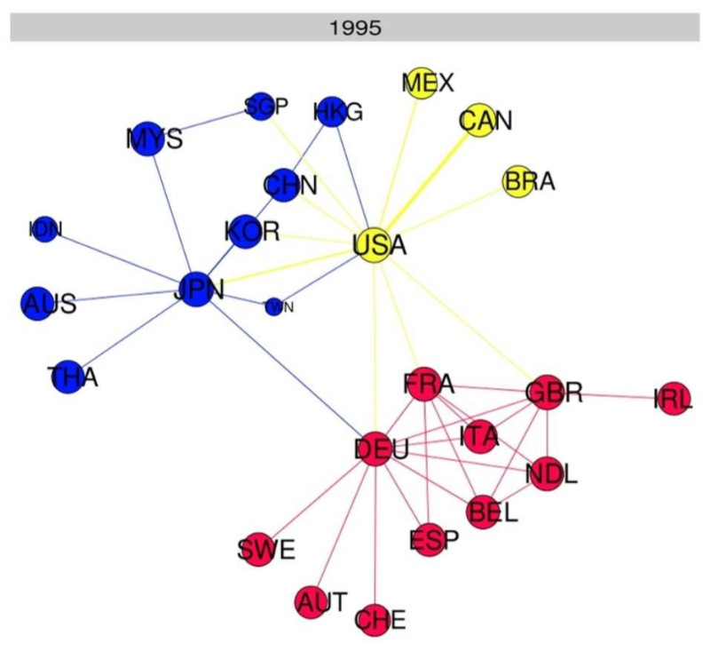

It is a simple representation of the international trade network (ITN) in the year 1995. It has 3 communities (denoted by different colors): Americas, Europe and Asia-Oceania. Each community has different nations in it, some nations with trade flows with multiple other nations (who have many linkages), some at the periphery with trade linkages with only a few nations. Intuitively speaking, it is easy to tell who is the **leader** or **core** of the community. For example, in the Asia-Oceania community (Blue), Japan (JPN) seems to have trade linkages with many nations. In the community of Americas (Yellow), USA clearly emerges as the leader. In the Europe community (Red), Germany (Deutschland/DEU) seems like the leader immediately followed by France (FRA) and Great Britain (GBR).

The paper gives an explanation of China's rise and the strategy it implemented. it argues that China first forged strong trade relationships with leaders and core of other communities (like USA, Germany) post its accession to the WTO in 2001, this improved China's global trade (or inter-community trade). This made China an attractive trade partner inside its region/community too, which can be seen through all the trade agreements China signed with nations in the Asia-Oceania community. It was globalization followed by regionalization. The entire paper is about understanding and reasoning this phenomena through analysis.

Let us get a closer understanding of this phenomena. The paper takes note of two key events and try to find a correlation between them. First is a global event, second is a regional event. Consider the following diagram.

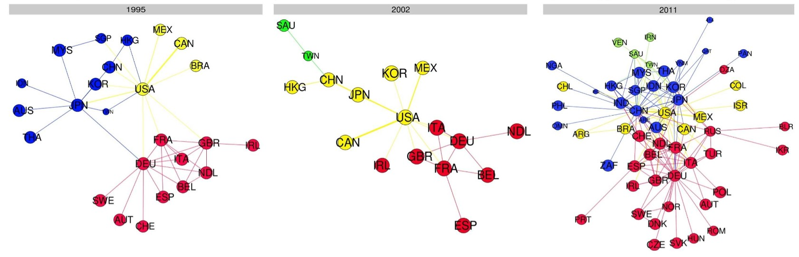

We now have snapshots of ITN for 3 years: 1995, 2002 and 2011. One can observe how the ITN has changed/evolved with time. In 2002, the Asia-Oceania community (Blue) seems to have disappeared and has merged with the Americas (Yellow). Post that, the Asia-Oceania reemerged as a distinct community again by 2011. This disappearance and reemergence of the entire Asia-Oceania community is a global event. At the same time, it can be observed how Japan was the leader of the Asia-Oceania community in 1995, but in 2011, it looks like China has emerged as the new leader/core of the community. This is a Asia-Oceania-specific regional event. The paper argues that there is a correlation with these two events and China's strategy can be explained using that.

The rest of the paper is about correlating these two events and finding a coherent narrative. To do this, the paper introduces a few concepts, starting with **community core**: What nations are the core of a community, what is the importance of each nation inside its own community. This tells us who are the trade leaders in that particular community. Consider the below diagram.

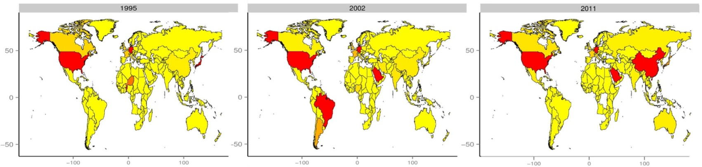

The Redder the nation, more important it is to its community. USA has always been one of the high importance nations inside its community for decades. In 1995, Japan is the only nation that is Red in the Asia-Oceania community pointing to its high importance. That disappeared in 2002 and is orange in 2011, whereas China has gone completely Red pointing to the fact that its importance in the Asia-Oceania is very high. This idea of community core helps us witness the regional event better.

Coming back to the correlation between the disappearance and reemergence of the Asia-Oceania community & China emerging as the regional core in the Asia-Oceania community, the paper considers the inter-community trade and intra-community trade of China (and its predecessor Japan).

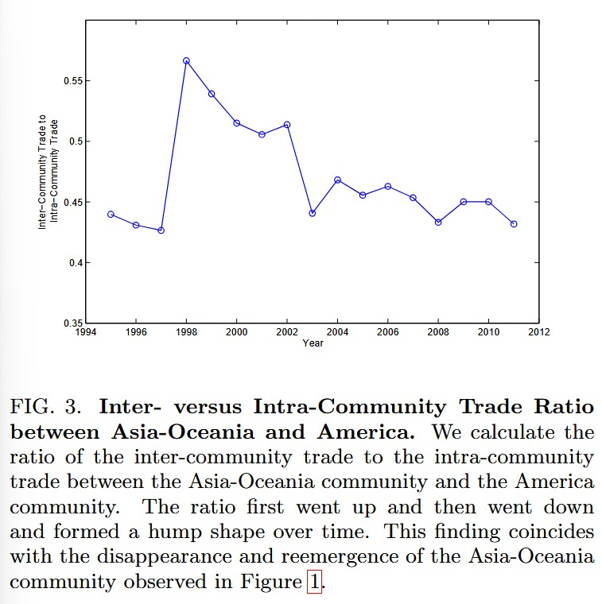

First of all, Inter-Community Trade is the trade that happens across communities. Intra-Community Trade is the trade that happens among the nations inside a community. The figure tells us where the inter-community trade (between Asia-Oceania and Americas) stood with respect to the respective intra-community trades. There seems to be a sharp increase in inter-community trade between the years 1997 and 2003 post which the ratio went back to usual average. It is suggested that the increase is because of the global trade relationships that were created between China and nations of other communities. The ratio going back to average might mean two things: The global trade reduced or the intra-community trade increased, and the latter is what seems to have happened. Asia-Oceania community went through a round of regionalization (also why Asia-Oceania emerged as a distinct community as seen earlier). But how can we say it was mainly because of China? Consider the following chart from the paper.

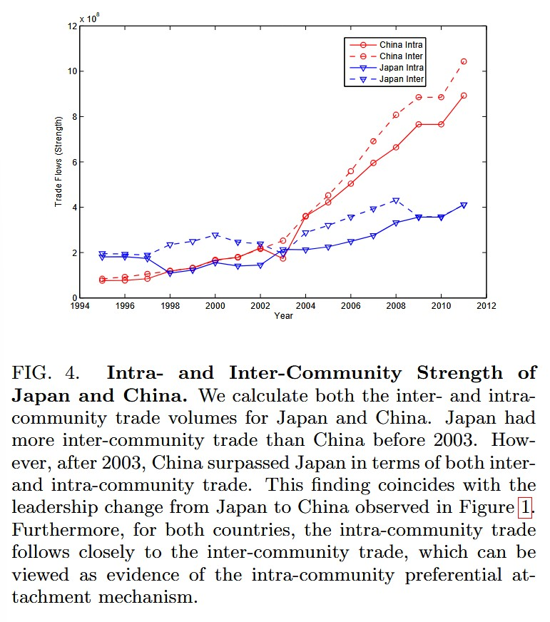

These are trade flows of China and Japan inside and outside of the Asia-Oceania community. Quite clearly China's inter and intra-community trade has significantly increased around the time of observation.

The intra-community trade improved and that was part of China's policy, which can be seen from the various trade agreements it has signed with nations inside the Asia-Oceania community. That is one way to corroborate the observations and reality.

The entire evolution is observed in 3 steps (as described in the beginning of the paper).

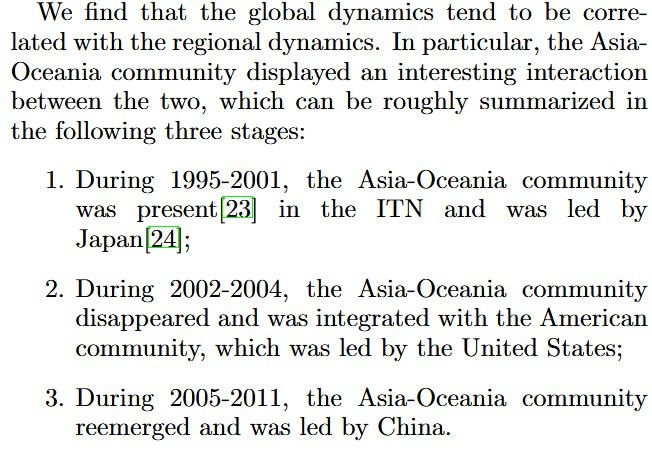

The abstract is a good one paragraph summary of the paper.

> Theory of complex networks proved successful in the description of a variety of static networks ranging from biology to computer and social sciences and to economics and finance. Here we use network models to describe the evolution of a particular economic system, namely the International Trade Network (ITN). Previous studies often assume that globalization and regionalization in international trade are contradictory to each other. We re-examine the relationship between globalization and regionalization by viewing the international trade system as an interdependent complex network. We use the modularity optimization method to detect communities and community cores in the ITN during the years 1995-2011. We find rich dynamics over time both inter- and intra-communities. Most importantly, we have a multilevel description of the evolution where the global dynamics (i.e., communities disappear or reemerge) tend to be correlated with the regional dynamics (i.e., community core changes between community members). In particular, the Asia-Oceania community disappeared and reemerged over time along with a switch in leadership from Japan to China. Moreover, simulation results show that the global dynamics can be generated by a preferential attachment mechanism both inter- and intra-communities. 

The authors use a number of tools and techniques like international trade network, observing its evolution, observing community cores, looking at intra and inter-community trades of nations under observation to explain the observed phenomena.

The ideal next step here would be to talk about each of sections in the paper in detail and plan the implementation. But one of the important pre-requisites to the next step is to understand how these communities that we have intuitively understood even generated from the international trade network. The concept of **community detection** is what makes it happen. So we take a deroute here to take a quick look into community detection and then go back to the paper.

## 2. What is Community Detection?

The world is full of large graphs. One can find graphs and complex networks in every field. One of the most intuitive variety of graphs are the social graphs [1], typically formed by big social media platforms, where people (or their accounts) are the nodes and the connections/follows are the edges. Knowledge Graphs [2] is one which has lots of knowledge sources linked together along with linkages to authors and users in a meaningful manner. Search companies like Google and Microsoft have their own knowledge graphs, DBpedia [3] is a knowledge graph built out of Wikipedia. The academic world also has knowledge graphs. One obvious example is where academic publications are the nodes and the citations can be seen as linkages (each of the large academic publishing companies would definitely have such knowledge graphs [15]). There are highly complex network structures found in biology [4], one example is cells as nodes and the variety of interactions they have with other cells as linkages. On the business side, we come across large logistics/transportation networks [16]. As we have seen, in economics, we have trade networks where goods and services flow from one nation to another.

One obvious characteristic you might observe in real world networks is that no two nodes are the same, the nodes are all different. Certain nodes tend to have higher importance, with the meaning of **importance** being very context-specific to the network at discussion. When it comes to social networks, nodes with very high influence (primarily measured by number of followers) are nodes of higher importance. In the context of knowledge graphs, there could be knowledge sources (websites, documents) which have been highly visited and are ranked higher than others. Or in the context of international trade in textile industry, China leads the production followed by India, Bangladesh and Vietnam, these are important nodes in the textile trade. Another example would be how France is a highly important node in the luxury industry. In all these examples, the linkages to these nodes are very high in number.

Going one step further, there can be group of nodes which are densely connected among each other but are sparsely/weakly connected to nodes outside of that group. Consider the following diagram.

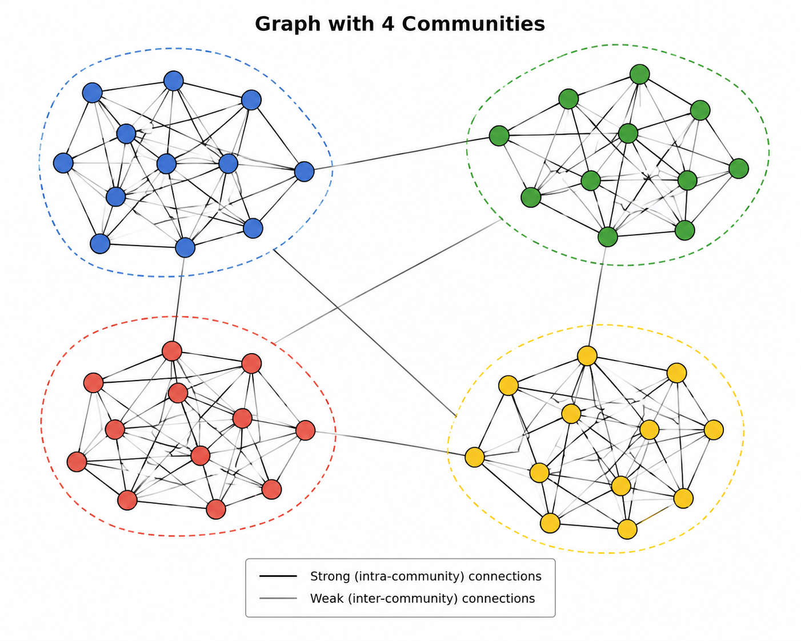

There are 4 groups of nodes which are strongly linked with each other, but weakly linked to other groups. Such groups can vaguely be defined as **communities**. We already saw communities in the international trade network and a glimpse into how they appear/disappear/merge/separate based on the interactions.

While the concept of communities inside a complex network is quite intuitive to understand, detecting and identifying them computationally is a non-trivial problem. To put it clearly, we have a complex network (nodes, edges and possibly weights for these edges), we need to find the communities. This problem is formally known as graph partitioning [13] in computer science. The graph is partitioned in different pieces based on certain condition. This is a known NP-Hard problem, meaning no polynomial-time algorithm exists, and the complexity to find those communities exponentially increases proportional to the number of nodes. There is a great deal of research on this very problem, and there are a variety of approaches to tackle it [5]. Of these approaches, this paper uses the **modularity optimization** method by Girvan and Newman [8]. There are a variety of algorithms based on this method, the landmark ones are as follows: Girvan-Newman [8], the introduction of **modularity** as the objective function for optimization [9] which is used now in different shapes and forms today as well, the 2008 Louvain algorithm [6] and the recent 2019 Leiden algorithm [7] which identified problems with the Louvain algorithm and suggested an improved method.

The authors in the paper use the Girvan-Newman algorithm [8] for community detection, but Louvain [6] and Leiden [7] are better. We would be using one of these for community detection. It is important to have a fair understanding of Louvain algorithm. I would suggest the reader to watch the video [17] and then the actual paper[6]. There is already a python implementation of the Louvain algorithm [18] with which one can experiment with to get a hang of it. For Leiden, I would suggest these: Video [19], paper [7], python implementation [20]. Consider the following sample example of Louvain algorithm in action. The below is a simple network, an unpartitioned one (one where community detection algorithm has not been executed).

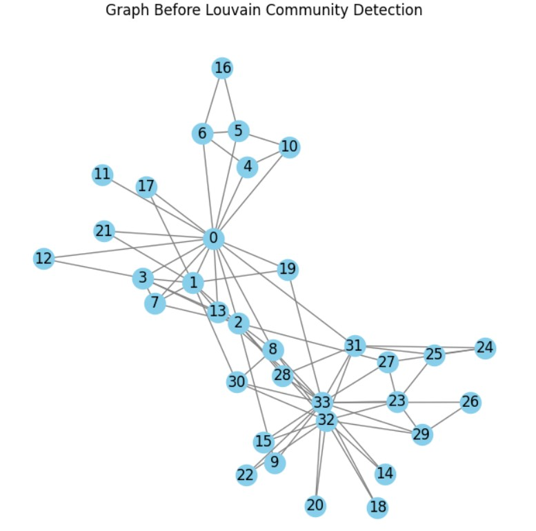

If we want to find the communities, we run the louvain algorithm and below is what we get.

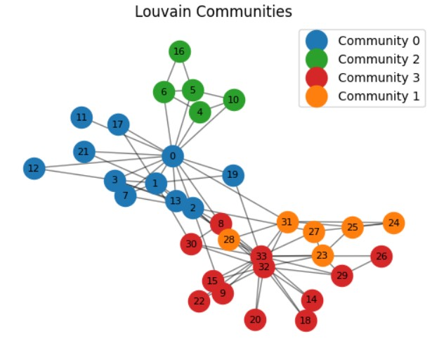

If you run the algorithm a couple of times, you might end up seeing a different partition, like this.

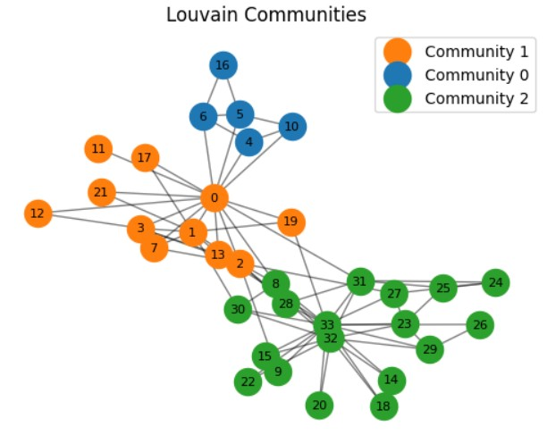

Similar to how we can get different clusters in K-means clustering, it can be told that Louvain is quite similar that way. The paper gives some explanation as to why it this way. You  may download the jupyter notebook here[21].

## 3. Implementation Plan

Now that we broadly know what the paper does and what community detection is, we can come up with an implementation plan. Here are the steps.

**1. Constructing ITN from Datasets**: This is the foundational step, where we take a closer look at the dataset, give it a good descriptive analysis and understand it better. Get the dataset for a particular time instance ready (say 1995) and implement the community detection algorithm (Louvain/Leiden) on it. We should have a rich descriptive analysis and visualization of the trade network of a particular time instance. As we saw earlier, the below is the ITN 1995 generated from the dataset.


**2. Evolution of ITNs over time**: Once we have the ITN construction solution for one time instance, we can incrementally apply the same solution for data of the time instances we want (say we want 1995, 2002, 2005, 2011 or more). We should have all the details for each of these ITNs. With that we should be able to see the global phenomenon of disappearance and reemergence of the Asia-Oceania community from the global ITN, and ideally be able to reproduce all the other relevant observations (like leaders of communities and change of leadership in Asia-Oceania community and so on) as seen below.


**3. Community Core Detection**: The paper then discusses community core detection, that tells us the importance of each node in its community. The below is the diagram from the paper. The community core detection is an incremental solution that can be programmed along with traditional community detection, which we will in this step (Check Sections IIB and Figure 1 in the paper [11]).


**4. Linkage between global and regional dynamics**: Step 2 should help us observe the global phenomenon of disappearance and reemergence of Asia-Oceania region as a community during 1997-2003. Step 3 should help us observe the regional phenonemon leadership change of Asia-Oceania community from Japan to China during the same time period. But those are observations. In this step, we conduct the analysis necessary to forge the linkage between the two (Section V in its entirety). We will look at the inter-community trade vs. intra-community trade we saw earlier and other details necessary to understand this link.

**5. Understanding agreements and policies**: The paper looks just at China's trade agreements inside and outside of its community to corroborate with the analysis performed earlier. Below is a table from the paper. We should go further and look at not just China's but other nations' as well.

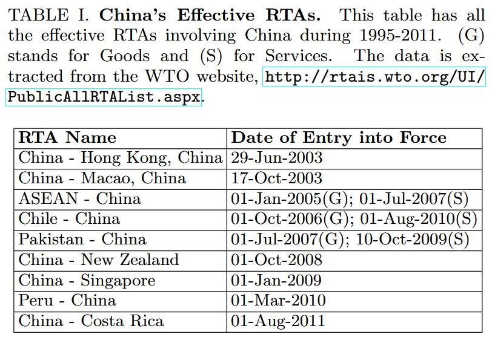

This should ideally cover all aspects of the paper, but we can have one more section to tie up the loose ends in case.

Let us start with the implementation.

## 4. Implementation, Analysis & Discussion

# 4.1 ITN Construction from Datasets

### 4.1.1 The BACI Dataset

Let us first take a good look at the dataset used in the paper. The paper uses the CEPII-BACI data

The CEPII [23](Centre d'Études Prospectives et d'Informations Internationales, in English it is "Center for Prospective Studies and International Information) is a French research institute for international economics with a focus on globalization, trade, macroeconomics and international finance. It offers a number of high quality datasets related to international trade and economics (tariffs & duties, bilateral trade flows, trade flows - balance of payments - world revenues to name a few). This publication makes use of the bilateral trade flows dataset called BACI [22] (```Base pour l'Analyse du Commerce International```, french for "Database for the Analysis of International Trade). As the description suggests,

> BACI provides data on bilateral trade flows for 200 countries at the product level (5000 products). Products correspond to the "Harmonized System" nomenclature (6 digit code).

This dataset has been updated and maintained from 1995 till date. It is a simple dataset with 3 items.

1. A country metadata file that maps country codes used in the dataset to country full names and ISO codes.   
2. A product metadata file that maps product codes to product names.   
3. The trade flow files which is the main data file.

Let us look at the dataset in a bit more detail. We will be using python for data analysis and visualization in this post. Lets start with country metadata file.

```python
# Nations
nations = pd.read_csv('BACI_HS22_V202601/country_codes_V202601.csv')
nations
```

| country_code | country_name                              | country_iso2 | country_iso3 |
|--------------|-------------------------------------------|--------------|--------------|
| 4            | Afghanistan                               | AF           | AFG          |
| 8            | Albania                                   | AL           | ALB          |
| 12           | Algeria                                   | DZ           | DZA          |
| 16           | American Samoa                            | AS           | ASM          |
| 20           | Andorra                                   | AD           | AND          |
| ...          | ...                                       | ...          | ...          |
| 876          | Wallis and Futuna Isds                    | WF           | WLF          |
| 882          | Samoa                                     | WS           | WSM          |
| 887          | Yemen                                     | YE           | YEM          |
| 891          | Serbia and Montenegro (...2005)           | CS           | SCG          |
| 894          | Zambia                                    | ZM           | ZMB          |

There are a total of 238 nations in this dataset. Looking at the products,

```python
# Let us look at the products first.
products = pd.read_csv('./BACI_HS22_V202601/product_codes_HS22_V202601.csv')
products
```

| code | description |
|------|-------------|
| 10121 | Horses: live, pure-bred breeding animals |
| 10129 | Horses: live, other than pure-bred breeding animals |
| 10130 | Asses: live |
| 10190 | Mules and hinnies: live |
| 10221 | Cattle: live, pure-bred breeding animals |
| ... | ... |
| 970531 | Collections and collectors' pieces: of numismatic interest |
| 970539 | Collections and collectors' pieces: of numismatic interest, other |
| 970610 | Antiques: of an age exceeding 250 years |
| 970690 | Antiques: of an age exceeding 100 years but not exceeding 250 years |
| 999999 | Commodities not specified according to kind |

There are a total of 5609 products. It feels like an exhaustive list of products, and each product with a variety of categories.

In the international trade network, the nations are the nodes, products are what flows from one nation to another in different quantities. Next is the main data file that gives data on those quantities, in graph terms, the edges between these nations.

```python
trade_flows = pd.read_csv('BACI_HS22_V202601/BACI_HS22_Y2024_V202601.csv')
trade_flows = trade_flows.rename(columns = {'t': 'year', 'i': 'exporter', 'j': 'importer', 'k': 'product', 'v': 'value', 'q': 'quantity'})
trade_flows
```

| year | exporter | importer | product | value | quantity |
|------|---------:|---------:|--------:|------:|---------:|
| 2024 | 4 | 24 | 80810 | 0.176 | 0.100 |
| 2024 | 4 | 24 | 330499 | 2.295 | 0.230 |
| 2024 | 4 | 24 | 732510 | 5.617 | 0.038 |
| 2024 | 4 | 24 | 848330 | 2.420 | 0.004 |
| 2024 | 4 | 24 | 853610 | 0.605 | 0.011 |
| ... | ... | ... | ... | ... | ... |
| 2024 | 894 | 858 | 610429 | 0.585 | 0.003 |
| 2024 | 894 | 858 | 848490 | 0.048 | 0.001 |
| 2024 | 894 | 858 | 870810 | 0.020 | 0.001 |
| 2024 | 894 | 860 | 60420 | 0.415 | 0.115 |
| 2024 | 894 | 860 | 120991 | 0.130 | 0.001 |

The exporter and importer are simply nation codes, there is the product code, value in thousand USD and quantity in metric tons. Essentially these are the edges in our international trade network, but the dataset provides it at a product level (not nation-level aggregate). There are 11250411 trade flows in total in this table.

And such a dataset is available for all years from 1995-2024.

This is a basic description of the dataset. You can find a detailed description in the paper that introduces the BACI dataset [24].

### 4.1.2 How do we use this dataset?

Certain preprocessing is necessary before we use dataset. First of all, the dataset provides data at product level granularity, but the publication talks about things at an aggregate level. Second is each entry in the trade flows dataset is directional in nature, where products are flowing from the exporter to the importer nation. But what would help us is to have the aggregate exchange of products between two nations. In other words, the graph currently is directional in nature, we need to make it an undirected graph. Once these are done, we will have to preprocess the dataset in such a way that python's louvain can consume it.

Coming to the preprocessing, let us first aggregate all the product-level flows to get nation-level flows. At the end of that transformation, we should have atmost 2 entries for two nations, one where the first nation is the exporter and another where the second nation is the exporter (two entries per two nations is not mandatory, it is possible that there is absolutely no trade between two nations, or a trade where one nation is a sole importer from another nation and so on). All in all, we should go from ```11250411``` entries to a maximum of ```238 * 238 * 2 = 113288``` entries. The table now looks like this:

| year | exporter | importer | product | value | quantity |
|------|---------:|---------:|--------:|------:|---------:|
| 2024 | 4 | 24 | 80810 | 0.176 | 0.100 |
| 2024 | 4 | 24 | 330499 | 2.295 | 0.230 |
| 2024 | 4 | 24 | 732510 | 5.617 | 0.038 |
| 2024 | 4 | 24 | 848330 | 2.420 | 0.004 |
| 2024 | 4 | 24 | 853610 | 0.605 | 0.011 |
| ... | ... | ... | ... | ... | ... |
| 2024 | 894 | 858 | 610429 | 0.585 | 0.003 |
| 2024 | 894 | 858 | 848490 | 0.048 | 0.001 |
| 2024 | 894 | 858 | 870810 | 0.020 | 0.001 |
| 2024 | 894 | 860 | 60420 | 0.415 | 0.115 |
| 2024 | 894 | 860 | 120991 | 0.130 | 0.001 |

Moving forward, we won't need the ```product``` and ```quantity``` columns because we want to aggregate at the nation level and will do it in dollar terms. We also know the data is for the year 2024, so we won't need the ```year``` column too. After dropping those columns, it now looks like the following.

```python
trade_flows.drop(columns=['year', 'product', 'quantity'], inplace=True)
trade_flows
```

| exporter | importer | value |
|----------:|----------:|------:|
| 4 | 24 | 0.176 |
| 4 | 24 | 2.295 |
| 4 | 24 | 5.617 |
| 4 | 24 | 2.420 |
| 4 | 24 | 0.605 |
| ... | ... | ... |
| 894 | 858 | 0.585 |
| 894 | 858 | 0.048 |
| 894 | 858 | 0.020 |
| 894 | 860 | 0.415 |
| 894 | 860 | 0.130 |

with 11,250,411 entries.

Now aggregating it at the exporter-importer pair level, we get,

```python
nation_trade_flows = (trade_flows.groupby(['exporter', 'importer'], as_index=False)
                                 .agg({'value': 'sum'}))
nation_trade_flows
```

| exporter | importer | value |
|----------:|----------:|------:|
| 4 | 24 | 11.577 |
| 4 | 31 | 34.561 |
| 4 | 32 | 5.943 |
| 4 | 36 | 1002.584 |
| 4 | 40 | 3056.578 |
| ... | ... | ... |
| 894 | 834 | 195830.184 |
| 894 | 842 | 183284.967 |
| 894 | 854 | 238.998 |
| 894 | 858 | 617.297 |
| 894 | 860 | 0.545 |

This table has 28909 entries. This is still directional in nature. What we want is a full aggregation at a nation-pair level. We have the following after bringing it all together.

```python
# Create an undirected pair key
nation_trade_flows[["nation1", "nation2"]] = pd.DataFrame(
    nation_trade_flows[["exporter", "importer"]].apply(lambda row: sorted(row), axis=1).tolist(),
    index=nation_trade_flows.index
)

undi_trade_flows = (nation_trade_flows.groupby(['nation1', 'nation2'], as_index=False)
                                     .agg({'value': 'sum'}))
undi_trade_flows
```


| nation1 | nation2 | value |
|---------:|---------:|------:|
| 4 | 24 | 11.577 |
| 4 | 31 | 548.289 |
| 4 | 32 | 5.943 |
| 4 | 36 | 1248.395 |
| 4 | 40 | 20832.847 |
| ... | ... | ... |
| 858 | 894 | 2182.142 |
| 860 | 862 | 344.482 |
| 860 | 887 | 182.167 |
| 860 | 894 | 4510.703 |
| 862 | 894 | 19.489 |

There are 16,249 entries in total. We now have a database of undirectional edges between nations at large, with edge-weights being the value of the trade between the two nations. Before moving forward, let us create a list of nations in this database, which will denote the exhaustive list of nodes we are dealing with.

```python
nations_list = pd.unique(undi_trade_flows[['nation1', 'nation2']].to_numpy().ravel())
nations_list = pd.DataFrame(nations_list, columns=['nation_name'])
nations_list
```

| nation_name |
|------------:|
| 4 |
| 24 |
| 31 |
| 32 |
| 36 |
| ... |
| 86 |
| 534 |
| 535 |
| 652 |
| 660 |

There are 226 nations in total.

### 4.1.3 Constructing the ITN

We have nodes and edges, let us construct the international trade network. Let us build a ```networkx``` out of the data we have. You can find the basic API for ```networkx``` here [25].

```python
import networkx as nx

# Creating an empty graph first
itn = nx.Graph()
```

Then add the nodes. The country code can be the official node value, but let us add other data attributes present in the ```nations``` dataframe.

```python
# Add nodes
for i in range(len(nations_list)):
    nation_code = int(nations_list.iloc[i]['nation_name'])
    nation_data = nations[nations['country_code'] == nation_code]
    nation_name = str(nation_data['country_name']).split('\n')[0].split()[1]
    nation_iso2 = str(nation_data['country_iso2']).split('\n')[0].split()[1]
    nation_iso3 = str(nation_data['country_iso3']).split('\n')[0].split()[1]
    itn.add_node(nation_code, nation_name = nation_name,
                  nation_iso2 = nation_iso2,
                  nation_iso3 = nation_iso3)

list(itn.nodes(data=True))[:10]itn.nodes()
```

It looks like this.

```json
[(4,
  {'nation_name': 'Afghanistan', 'nation_iso2': 'AF', 'nation_iso3': 'AFG'}),
 (24, {'nation_name': 'Angola', 'nation_iso2': 'AO', 'nation_iso3': 'AGO'}),
 (31,
  {'nation_name': 'Azerbaijan', 'nation_iso2': 'AZ', 'nation_iso3': 'AZE'}),
 (32, {'nation_name': 'Argentina', 'nation_iso2': 'AR', 'nation_iso3': 'ARG'}),
 (36, {'nation_name': 'Australia', 'nation_iso2': 'AU', 'nation_iso3': 'AUS'}),
 (40, {'nation_name': 'Austria', 'nation_iso2': 'AT', 'nation_iso3': 'AUT'}),
 (44, {'nation_name': 'Bahamas', 'nation_iso2': 'BS', 'nation_iso3': 'BHS'}),
 (48, {'nation_name': 'Bahrain', 'nation_iso2': 'BH', 'nation_iso3': 'BHR'}),
 (51, {'nation_name': 'Armenia', 'nation_iso2': 'AM', 'nation_iso3': 'ARM'}),
 (52, {'nation_name': 'Barbados', 'nation_iso2': 'BB', 'nation_iso3': 'BRB'})]
```

Similarly, we add the edges too.

```python
# Adding the edges
for i in range(len(undi_trade_flows)):
    # Get the edge and its attributes
    edge = i    # Edge no
    edge_data = undi_trade_flows.iloc[i]
    itn.add_edge(int(str(int(edge_data[0]))), # nation1
                 int(str(int(edge_data[1]))),   # nation2
                 trade_value = float(edge_data[2]))

list(itn.edges(data=True))[:10]itn.edges(data=True)
```

It looke like the following.

```json
[(4, 24, {'trade_value': 11.577}),
 (4, 31, {'trade_value': 548.289}),
 (4, 32, {'trade_value': 5.943}),
 (4, 36, {'trade_value': 1248.395}),
 (4, 40, {'trade_value': 20832.847}),
 (4, 44, {'trade_value': 76.15700000000001}),
 (4, 48, {'trade_value': 1544.8110000000001}),
 (4, 51, {'trade_value': 36.365}),
 (4, 52, {'trade_value': 60.861}),
 (4, 56, {'trade_value': 52433.845})]
```

The ITN is essentially constructed, but let us visualize it to get a better picture.

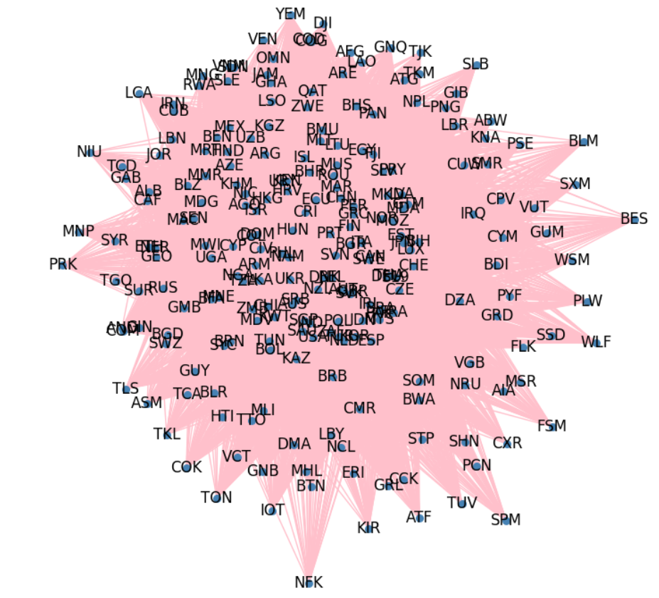

There are 226 countries in total (which are in the trade flows graph), there can be a maximum of ```226*(226-1)/2 = 25425``` edges. We have a total of 16249 edges, density is 64%. This is a highly dense graph and hard to make any sense out of it. There are a couple of options here. First is we take the top 200-300 trade flows/edges and prune all other graphs - this way, we would be covering all the major trade flows (among the largest of the economies in the world). Another is we just use the list of countries the publication seems to demonstrate in their diagrams. Let us take up the first option and see if we can arrive at the diagram the paper has produced. Considering the top 300 trade flows, we see that 70 countries are participating in it and it looks like the following:

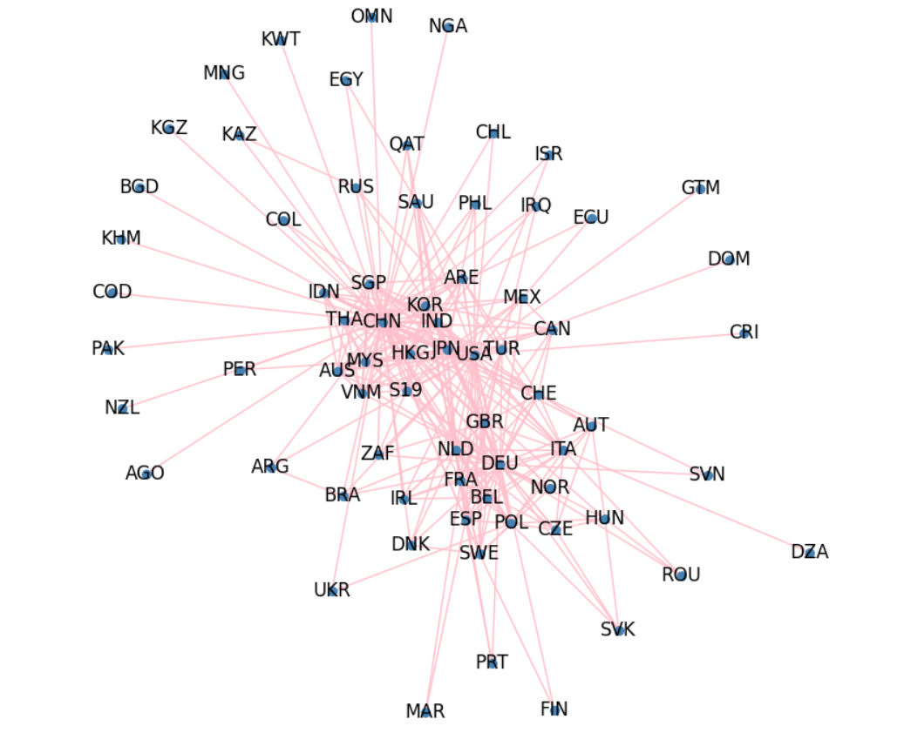

It is slowly starting to look like the ITNs in the paper. After experimenting with couple of top N trade flows, I think 150 trade flows gives a clear picture we are looking for.

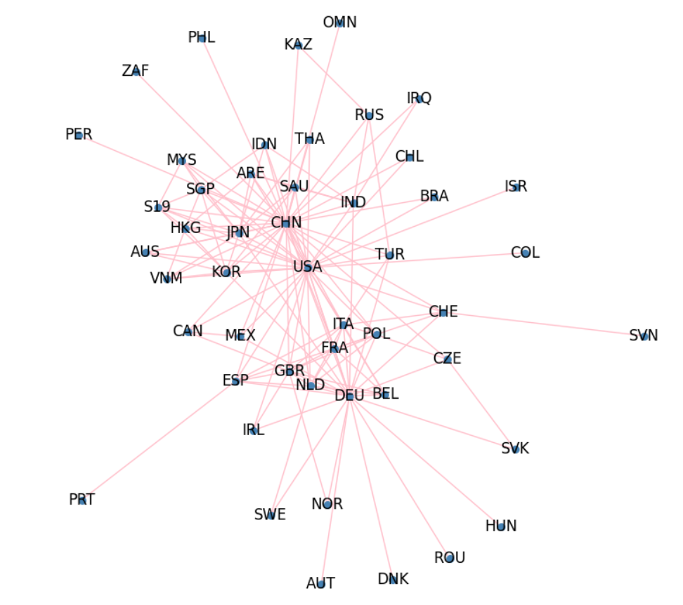

The cores are very clearly visible: China, USA, Germany. For analytical purposes, let us create the exact amount of trade each nation here is involved in. Below is the list we get for all the 49 countries involved in ITN-150.

```
('CHN', 4798279287.078001)
('USA', 4487609923.554)
('DEU', 2415394561.369)
('JPN', 1072025161.5209999)
('MEX', 968143679.3289999)
('FRA', 897999387.957)
('KOR', 889200719.9139999)
('CAN', 849597475.4979999)
('NLD', 822123945.0260003)
('GBR', 755682593.678)
('ITA', 746157101.2390001)
('HKG', 624137024.1249999)
('S19', 613908694.772)
('VNM', 575692824.076)
('IND', 566569229.636)
('ESP', 492003994.87299997)
('BEL', 490606129.27)
('SGP', 476474793.52000004)
('POL', 443061573.81799996)
('CHE', 396281432.99300003)
('MYS', 392326873.45400006)
('RUS', 376892554.656)
('AUS', 361462986.964)
('ARE', 333028487.618)
('SAU', 290971817.236)
('IDN', 282710686.621)
('THA', 259042823.949)
('BRA', 250458588.829)
('CZE', 232183949.797)
('TUR', 195854721.737)
('IRL', 180585268.891)
('AUT', 130558256.537)
('CHL', 89360562.035)
('IRQ', 87378594.561)
('SWE', 78136326.15900001)
('NOR', 72728563.514)
('SVK', 72540769.847)
('HUN', 70390445.298)
('KAZ', 65047795.519999996)
('PRT', 56675453.524000004)
('PHL', 56512534.34199999)
('ZAF', 49514061.236)
('ROU', 45007143.859)
('DNK', 40906774.96)
('PER', 40036449.126)
('SVN', 38684634.689)
('OMN', 36696104.64)
('ISR', 31977374.733000003)
('COL', 31487152.472)
```

In the context of the top 150 trade flows as of the year 2024, China tops the list with $4.8 Trillion worth trade, followed by US with $4.4 trillion and then a distant third is Germany with $2.4 trillion worth trade.

The final step in the construction of ITN is the creation of communities. Instead of the algorithm used in the paper (Girvan-Newmann), we'll use the Leiden algorithm, which is supposed to be better at partitioning graphs than all its predecessors. Note that the communities that get generated are purely based on the edge weights (total bilateral trade flows between two countries, it has nothing to do with their geographical proximity). Post applying the algorithm, we get the below partition.

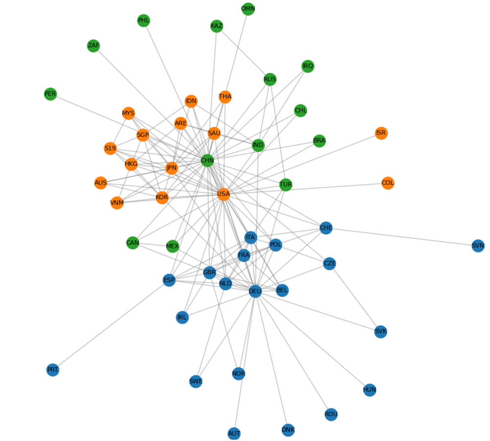

There are 3 communities: Green, Orange and Blue. The Green community, centered around China can be classified as the Asia-Oceania community, the Orange centered around USA is the Americas community and the Blue around Germany (DEU/Deutschland) is the Europe community. Note that this is as of 2025. Interesting to see Canada and Mexico classified as Green, showing they are closer to Asia-Oceania/China, and Japan part of the Americas. Listing down the actual country names for each community.

| Partition 0 | Partition 1 | Partition 2 |
|--------------|--------------|--------------|
| Germany | USA | Mexico |
| Netherlands | China (Hong Kong SAR) | Canada |
| France | Japan | China |
| Poland | Republic of Korea | Russian Federation |
| Italy | Viet Nam | Brazil |
| Belgium | Australia | India |
| United Kingdom | Other Asia | Chile |
| Austria | Malaysia | Philippines |
| Czechia | Indonesia | Iraq |
| Switzerland | Thailand | South Africa |
| Ireland | Saudi Arabia | Türkiye |
| Spain | United Arab Emirates | Peru |
| Hungary | Singapore | Kazakhstan |
| Portugal | Israel | Oman |
| Sweden | Colombia | |
| Romania | | |
| Slovakia | | |
| Denmark | | |
| Slovenia | | |
| Norway | | |

Leiden algorithm just like other modularity optimization algorithms can generate different communities each time you run, but the most important countries in each community (the **cores**) should generally remain in their own communities.

With that, we have come to the end of phase 1 of the paper implementation, which was constructing ITNs. We now have some tools to construct ITNs of any year, of any size based on top N trade flows, visualize them, parititon them into communities based on trade flows.

You can find all the code and results [here](https://github.com/adwait1-g/economics-papers/tree/main/1.%20Analysis%20of%20ITN%20%26%20Community%20Detection).

## 4.2 Global Dynamics & Evolution of ITNs

With the capability built in the first phase, the ITN can quickly be generated for any given year. Let us create the ITNs for the years 1995, 2002 and 2011.

Starting with the ITN for the year 1995, a total of 213 countries are seen to be part of the overall international trade, with 11104 undirected trade flows among countries. The below is a sample of how the ITN looks like, for the top 150 trade flows.

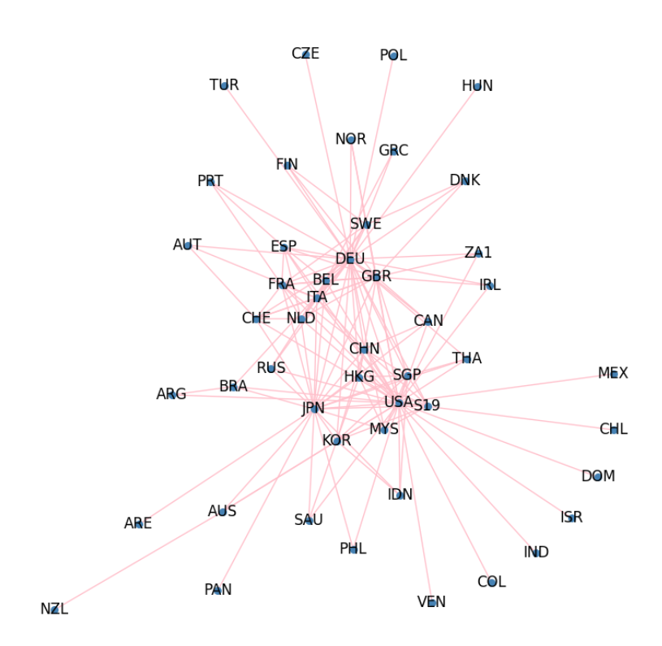

Listing the top 10 countries involved in the above ITN:

```
('USA', 1267441610.0029998)
('DEU', 845381728.0379999)
('JPN', 697906557.0060002)
('FRA', 415733189.817)
('GBR', 393903759.00499994)
('ITA', 296053186.88000005)
('CAN', 289490686.69900006)
('CHN', 288280919.39)
('NLD', 249594114.124)
('BEL', 232726153.036)
```

The visualization of the top 50 flows gives a very clear picture, like the one in the publication.

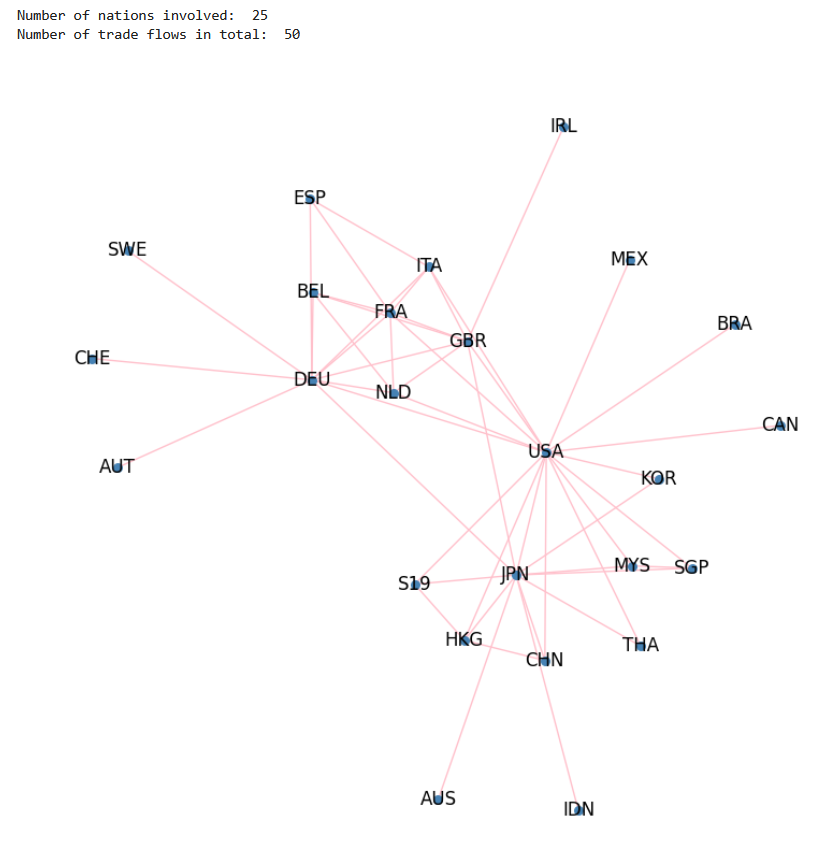

For this instance, USA, Japan, Germany, France and Great Britain (UK) seem like the important countries. This is how the countries get divided into different communities on partitioning.

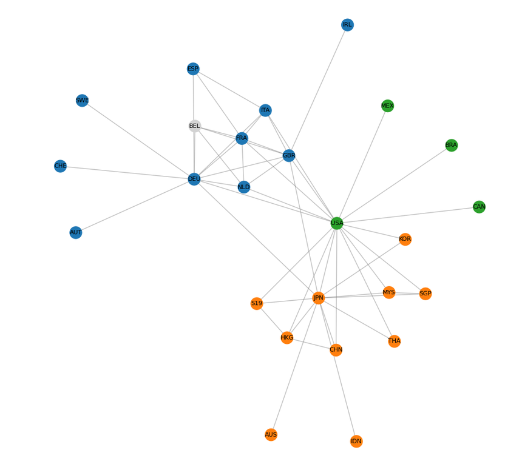

There are predominantly 3 communities: Europe, Americas and Asia-Oceania. Please note that these were partitioned solely based on trade-flows (and no geographical data was fed). Germany and France seem to be the cores of the Europe community, USA of the Americas and clearly Japan in the Asia-Oceania community.

It should be noted that this is one of the partitions obtained, that looked like the one in the publication. The fact of the matter is there is quite a bit of variability in community creation due to Leiden algorithm, Japan and USA were part of the same community in a large number of partition instances, like the one below.

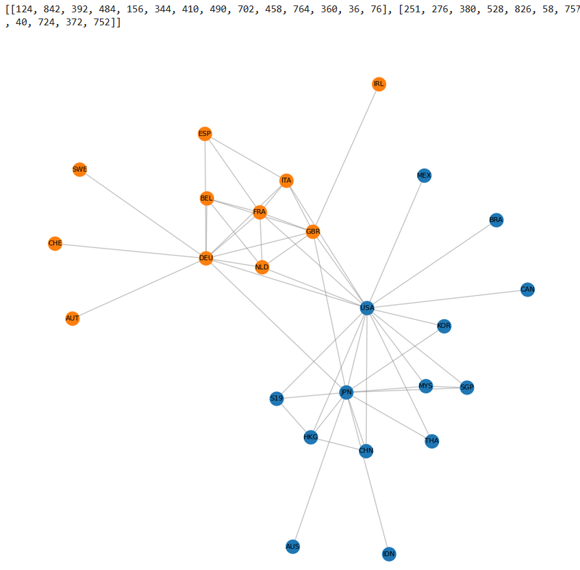

The authors note that this merging of the Asia-Oceania community with the Americas community (or the disappearance of the Asia-Oceania community) is observed in the year 2002, but this is actually seen in 1995 itself. It is possible that the 'merge' phenomenon isn't very pronounced because certain partitions do end up in the creation of a separate Asia-Oceania community.

Moving on to the year 2002, a total of 223 countries are seen to have participated in the international trade, pointing to the fact that more number of countries have now become a part of the international trade community. There are a total of 15823 undirected trade flows (as opposed to 11104 in 1995) pointing to the fact that the existing countries might have increased their trade participation. Below is how the ITN looks for the top 50 flows.

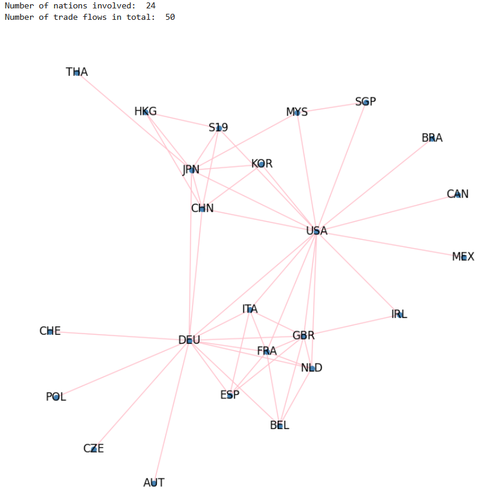

The below are the top 10 countries when top 50 flows are considered.

```
('USA', 1428677122.105)
('DEU', 747406523.304)
('CHN', 489630747.911)
('JPN', 477672991.3000001)
('FRA', 391843364.82600003)
('GBR', 371428068.07900006)
('CAN', 338624765.696)
('MEX', 240412948.6)
('ITA', 226547860.706)
('NLD', 211670321.191)
```

China has grown to become one of the top 5 countries in international trade. Just considering the top 50 trade flows might lead to a flawed inference in the sense that China is still behind Japan when it comes to overall trade flows (as of 2002), and that can be confirmed by taking a large number of flows and checking the top 10 nations.

```
('USA', 1840899021.1840007)
('DEU', 1042399455.8)
('JPN', 755591477.996)
('CHN', 718149257.2589998)
('FRA', 592703112.003)
('GBR', 592549973.5419998)
('ITA', 457016341.92100024)
('CAN', 428959024.347)
('NLD', 353296419.8600001)
('BEL', 338405131.4190001)
```

This shows that considering the top 50 flows for making inferences is not the best thing to do. Total trade in dollar value also seems to change drastically if more flows are added. The total trade for each country seems to stabilize at around 500 flows (USA has a total trade of $1.8T and it remains between $1.8T to $1.9T from 500 to 5000 flows).

That aside, China rising in positions in international trade now creates a very pronounced Asia-Oceania community when the ITN is partitioned.

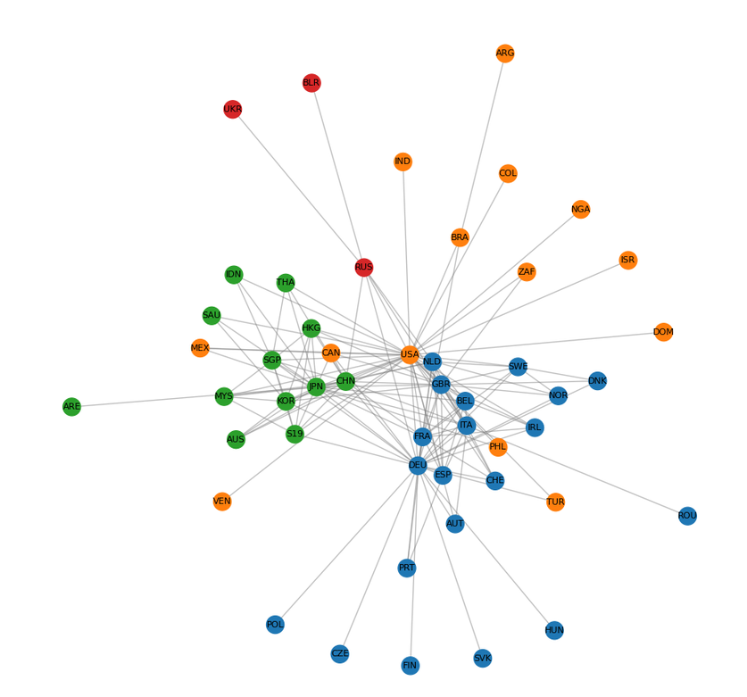

Of all the partitions I created, I saw the Asia-Oceania community clearly emerging as an independent entity. The paper declares that China has emerged as the core/leader of the Asia-Oceania community by 2002. But going by the trade flows (in dollar value), Japan is still ahead of China. Consider the following table.

```
| Country | 1995 | 2002 |
| ------- | ---: | ---: |
| China   |  196 |  206 |
| Japan   |  207 |  215 |
```

As of 2002, Japan is still ahead of China, but by a very small margin (both in terms of trade volumes and number of countries with trade relations). China has grown tremendously in 7 years, both in terms of trade volumes and making new trade relations.

The paper observes that disappearance of the Asia-Oceania community in the year 2002, but it seems that the Asia-Oceania community has already re-emerged as an independent community as of 2002. I did not see any partition (out of the 50 leiden runs) where the Asia-Oceania community was merged with the Americas. The observations made in the paper are seen here but with certain lead time (the disappearance of Asia-Oceania community was observed in 1995 opposed to 2002 as mentioned in the paper).

In 2011, a total of 225 countries participated in global trade with 17886 trade flows among countries. Considering the top 150 flows, the below is how the ITN looks.

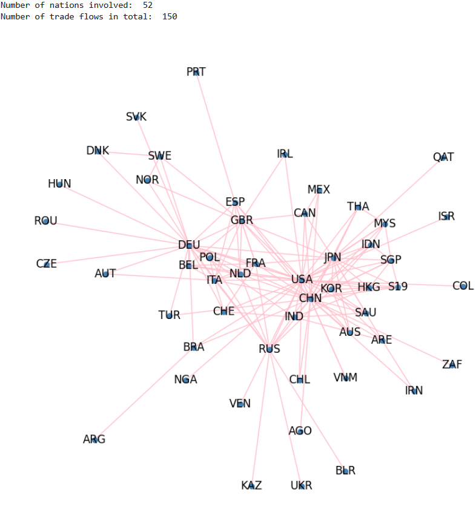

The below are the top 10 based on 150 flows.

```
('USA', 3121803764.526001)
('CHN', 3045747469.6909995)
('DEU', 2112043863.6500003)
('JPN', 1344853748.792)
('FRA', 849666658.3690001)
('GBR', 744932803.554)
('KOR', 709152873.6930001)
('NLD', 685046452.9330001)
('CAN', 676857837.951)
('ITA', 642599215.5579998)
```

China has grown leaps and bounds in terms of international trade, leaving behind Japan in the 4th place by a large margin. The below is how the partition looks.

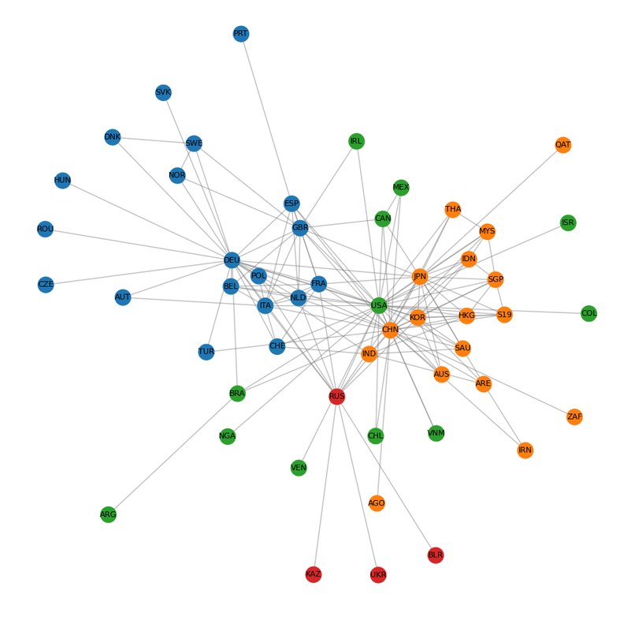

The positions have become more pronounced in 2011. Along with that, a large number of countries (like Australia, Saudi Arabia etc.,) who were all part of the Americas community, largely in trade with USA are now conducting high volume trade with China as well, and is depicted by them being part of the Asia-Oceania community (orange).

Just to check the latest status, let us look at the ITN as of 2024. There are 226 countries participating in international trade with 16871 trade flows among them. Below is the ITN for top 50 flows.

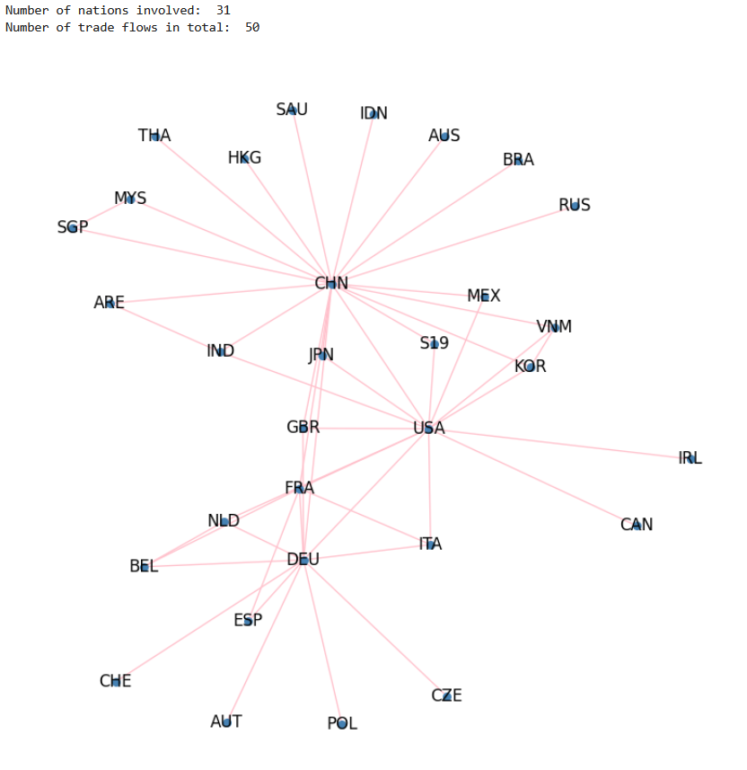

This conveys that China, USA and Germany seem to be the countries of importance in their communities. The below are the top 10 countries based on the ITN build using top 50 trade flows.

```
('CHN', 4036426167.428001)
('USA', 3637987468.9399996)
('DEU', 1831118181.109)
('MEX', 854581165.039)
('FRA', 685469721.656)
('CAN', 658125853.738)
('KOR', 586908713.681)
('JPN', 525871727.586)
('VNM', 492621991.83000004)
('NLD', 431939633.14500004)
```

Coming to India, it has grown with time as well. As of 2024, it stands in the 11th position in this list.

Looking at the communities,

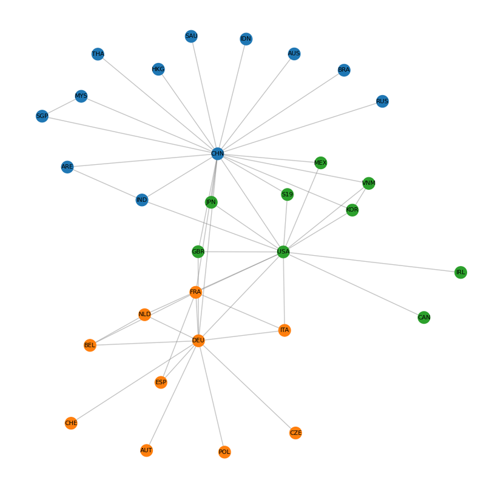

More realistic picture would be taking the top 150 flows for the ranking and partition.

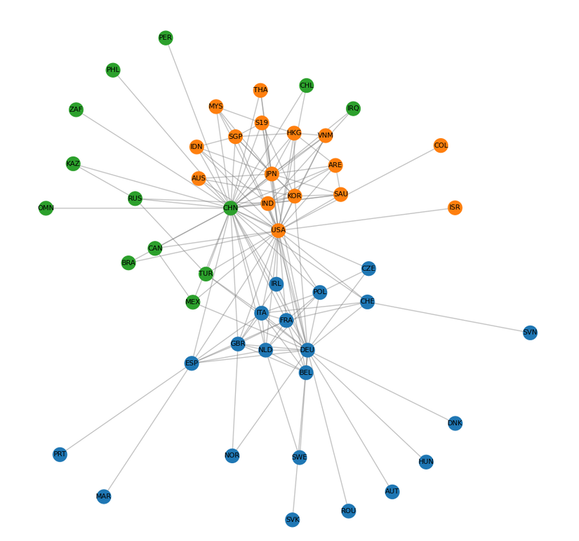

I see this particular partition getting created consistently across leiden executions. Japan and India are part of the Americas community (orange), Brazil, Canada and Mexico who were previously part of the Americas are now part of the Asia-Oceania community (green).

From the paper implementation standpoint, we have observed the global dynamics the authors discuss in Section-IV-A. We did see the disappearance and clear re-emergence of the Asia-Oceania community, with it getting merged into the Americas community for a short time period. It was also observed that China and Japan over different years and how China with time rose to the top of the international trade rankings (in terms of dollar value).

## 4.3 Regional Dynamics and Community Core Detection

By studying the evolution of ITNs with time, we observed certain aspects of global trade dynamics, specifically the phenomenon of the Asia-Oceania community disappearing and re-emerging as a distinct community over time. In this section, we will look at the concept of leader/core of a community in a more formal sense, and observe possible change in leadership in communities with time. The paper specifically talks about the change in leadership of the Asia-Oceania community from Japan to China. The paper uses very specific time instances (1995, 2002, 2011) to make a point, but we would be more flexible and just see if this particular phenomenon is observed.

Before going into the paper, let us conduct some analysis on Japan and China and how their stature has changed over time in the international trade network.

Let us look at 4 data points for each country for a given time instance:

1. Total international trade volume (in $)   
2. Total number of countries across globe with which trade relation was present
3. Total regional trade volume (in $)
4. Total number of countries in the region with which trade relation was present

So far, even though we called the communities based on the actual region, it could contain a country which is not from that region. For example, Japan was part of the Americas community in 1995 as per our observation, India as of 2024 is part of the Americas community. So the community generated from data did not coincide with the actual region. But now, we specifically want to look at trade a country has with countries of that particular region. The focus is the Asia-Oceania region, so we make a list of all countries in this region and check the trade relations China and Japan has had over the years.

Starting 1995, we can look at these data points for every 5 years for both Japan and China. This should give a cursory idea of how Japan and China has changed globally and regionally.

**To be continued**.


## 5. Future Work and Conclusion

This post is the foundation article of the paper implementation [11]. The first 2 phases of implementation and analysis are complete with the initial analysis on the third. Rest will be updated inside the same article in due time. Thank you for reading.

Cheers!   
Adwaith

## References

1. [The Rise of Social Graphs for Businesses - HBR](https://hbr.org/2015/02/the-rise-of-social-graphs-for-businesses)    
2. [Knowledge Graphs on the Web: An Overview](https://arxiv.org/pdf/2003.00719)   
3. [DBpedia: A Nucleus for a Web of Open Data - 2007](https://link.springer.com/chapter/10.1007/978-3-540-76298-0_52)    
4. [Scale-free Networks in Cell Biology by R. Albert, 2005](https://arxiv.org/pdf/q-bio/0510054)     
5. [Community Structure in Graphs: 2007](https://arxiv.org/pdf/0712.2716)   
6. [Fast unfolding of communities in large networks - the Louvain algorithm, 2008](https://arxiv.org/abs/0803.0476)   
7. [From Louvain to Leiden: Guaranteeing well-connected communities, 2018](https://arxiv.org/abs/1810.08473)   
8. [Finding and evaluating community structure in networks: Girvan & Newman algorithm, 2002](https://arxiv.org/abs/cond-mat/0308217)    
9. [Modularity and community structure in networks: Newman, 2006](https://arxiv.org/abs/physics/0602124)    
10. [Identifying the Community Structure of the International-Trade Multi Network, 2011](https://arxiv.org/abs/1009.1731)   
11. [The Rise of China in the International Trade Network: A Community Core Detection Approach, 2014](https://arxiv.org/abs/1404.6950)   
12. [Asia-Oceania, by Ministry of Foreign Affairs, Japan](https://www.mofa.go.jp/policy/other/bluebook/2016/html/chapter2/c020100.html)   
13. [Graph Partitioning, Wikipedia](https://en.wikipedia.org/wiki/Graph_partition)    
14. [Firm-to-Firm Trade Networks: A Focus on Latin-America and the Carribean](https://publications.iadb.org/publications/english/document/Firm-to-Firm-Trade-Networks-A-Focus-on-Latin-America-and-the-Caribbean.pdf)    
15. [Springer SN SciGraph](https://communities.springernature.com/users/82895-sn-scigraph)    
16. [Community core detection in transportation networks, 2013](https://arxiv.org/pdf/1304.0141)   
17. [Discovering Communities: Modularity & Louvain, Splience 2023 - Video](https://www.youtube.com/watch?v=Xt0vBtBY2BU)    
18. [python-louvain](https://github.com/taynaud/python-louvain)   
19. [Leiden Algorithm Explained: A Smarter Way to Detect Communities in Networks - Video](https://www.youtube.com/watch?v=hIQM0XLyQiQ)   
20. [leidenalg - python package](https://leidenalg.readthedocs.io/en/stable/)   
21. [Louvain - Example](/assets/2026-07-12-analysis-of-itns-community-detection/Louvain-sample.ipynb)  
22. [The CEPII-BACI dataset](https://www.cepii.fr/DATA_DOWNLOAD/baci/doc/baci_webpage.html)   
23. [CEPII](https://www.cepii.fr/cepii/en/bdd_modele/bdd_modele.asp)   
24. [BACI publication](https://www.cepii.fr/pdf_pub/wp/2010/wp2010-23.pdf)   
25. [Networkx documentation page](https://networkx.org/documentation/networkx-1.7/tutorial/tutorial.html)   
