Hello,

This article continues the implementation and analysis of this paper [1]. The paper is about the studying of the international trade network (ITN) using certain community detection techniques. The paper particularly observes the rise of China in international trade. In the first part of this article [2], we built the foundation: Got an overview of the paper, built a paper implementation plan and implemented the first two of the total five phases, which was about constructing the international trade network (ITN) using the CEPII-BACI dataset which is publicly available, and then comparing the ITNs for different time instances (1995, 2002, 2011, 2024) to get a better picture of how the international trade network has evolved over the decades. In the process, we were able to observe some interesting global dynamics in the ITN. To get a clear understanding of this part, reading atleast the first few sections of the previous part is necessary.

Below is the entire implementation plan for reference.

**1. Constructing ITN from Datasets**: This is the foundational step, where we take a closer look at the dataset, give it a good descriptive analysis and understand it better. Get the dataset for a particular time instance ready (say 1995) and implement the community detection algorithm (Louvain/Leiden) on it. We should have a rich descriptive analysis and visualization of the trade network of a particular time instance. As we saw earlier, the below is the ITN 1995 generated from the dataset.

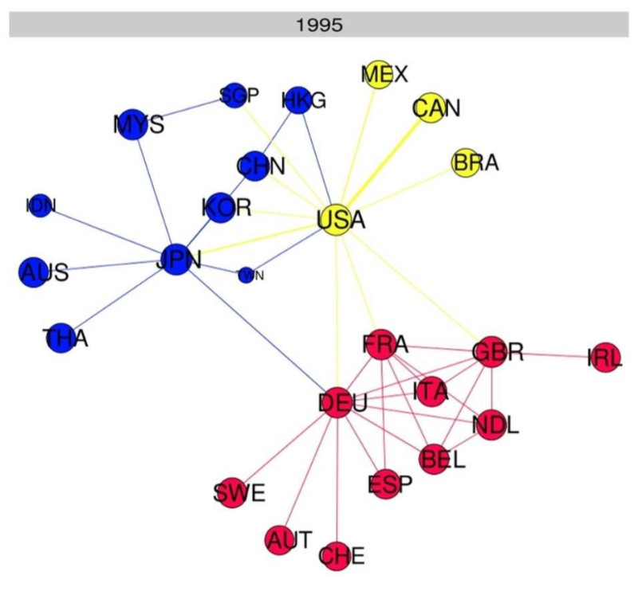

**2. Evolution of ITNs over time**: Once we have the ITN construction solution for one time instance, we can incrementally apply the same solution for data of the time instances we want (say we want 1995, 2002, 2005, 2011 or more). We should have all the details for each of these ITNs. With that we should be able to see the global phenomenon of disappearance and reemergence of the Asia-Oceania community from the global ITN, and ideally be able to reproduce all the other relevant observations (like leaders of communities and change of leadership in Asia-Oceania community and so on) as seen below.

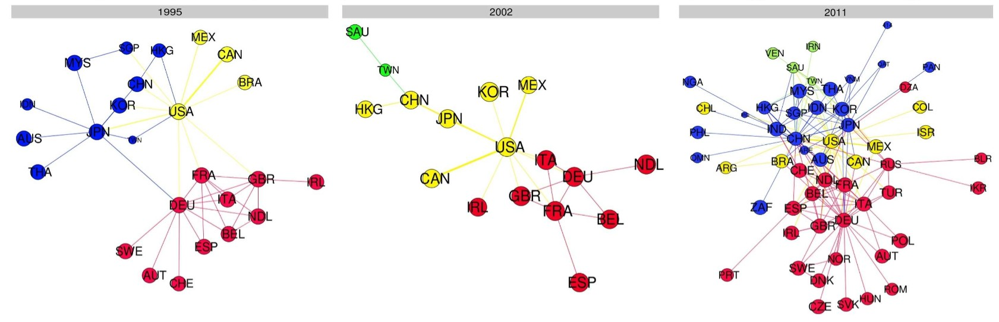

**3. Community Core Detection**: The paper then discusses community core detection, that tells us the importance of each node in its community. The below is the diagram from the paper. The community core detection is an incremental solution that can be programmed along with traditional community detection, which we will in this step (Check Sections IIB and Figure 1 in the paper [11]).

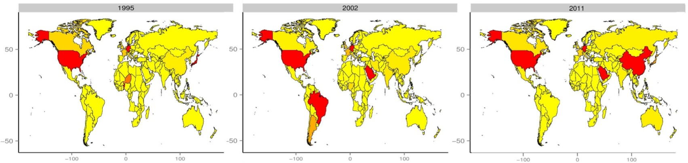

**4. Linkage between global and regional dynamics**: Step 2 should help us observe the global phenomenon of disappearance and reemergence of Asia-Oceania region as a community during 1997-2003. Step 3 should help us observe the regional phenonemon leadership change of Asia-Oceania community from Japan to China during the same time period. But those are observations. In this step, we conduct the analysis necessary to forge the linkage between the two (Section V in its entirety). We will look at the inter-community trade vs. intra-community trade we saw earlier and other details necessary to understand this link.

**5. Understanding agreements and policies**: The paper looks just at China's trade agreements inside and outside of its community to corroborate with the analysis performed earlier. Below is a table from the paper. We should go further and look at not just China's but other nations' as well.

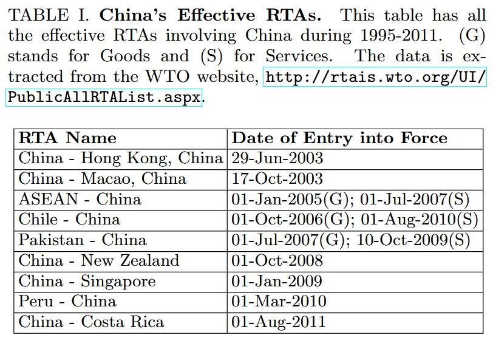

In the previous part, the first two parts were completed.

In this post, we will take up the rest of the phases: That would be studying the regional dynamics with the help of a community core detection technique, and understanding the high correlation between the global dynamics (observed in the previous part) and the regional dynamics. Finally, we corroborate the analysis with actual WTO data.

# 3. Regional Dynamics & Community Core Detection

By studying the evolution of ITNs with time, we observed certain aspects of global trade dynamics, specifically the phenomenon of the Asia-Oceania community disappearing and re-emerging as a distinct community over time. In this section, we will look at the concept of leader/core of a community in a more formal sense, and observe possible change in leadership in communities with time. The paper specifically talks about the change in leadership of the Asia-Oceania community from Japan to China. The paper uses very specific time instances (1995, 2002, 2011) to make a point, but we would be more flexible and just see if this particular phenomenon is observed.

In the previous part, we looked at the below summary table of how the total trade of the top 5-6 countries has evolved with time.

| Country |          1995 |          2000 |          2005 |          2010 |          2015 |          2020 |          2024 |
| ------- | ------------: | ------------: | ------------: | ------------: | ------------: | ------------: | ------------: |
| CHN     |   364,285,443 |   597,293,645 | 1,540,091,754 | 3,044,170,004 | 3,711,505,651 | 4,367,215,770 | 5,751,508,341 |
| DEU     |   935,348,574 |   992,407,531 | 1,678,306,875 | 2,156,323,438 | 2,232,900,199 | 2,399,998,338 | 2,827,469,851 |
| FRA     |   555,379,433 |   615,028,394 |   926,550,102 | 1,117,868,683 | 1,072,857,642 | 1,065,111,759 | 1,374,599,086 |
| GBR     |   494,750,248 |   639,441,339 |   871,652,346 |   965,067,395 | 1,009,349,367 |   975,188,725 | 1,127,014,120 |
| JPN     |   794,853,108 |   883,088,852 | 1,149,817,864 | 1,494,277,002 | 1,293,077,515 | 1,316,881,697 | 1,479,694,881 |
| USA     | 1,379,244,623 | 2,001,798,376 | 2,583,139,119 | 3,116,578,993 | 3,622,683,802 | 3,643,487,514 | 5,036,075,430 |

While this summary table is for the entire international trade, in this section, we need more information on the regional trade, specifically in the Asia-Oceania community. Below are the ISO3 country codes for the geographical Asia-Oceania region (and not the Asia-Oceania community generated by the partition in the previous past).

```python
asia_oceania_iso3 = [
    "AFG", "ARM", "AUS", "AZE", "BHR", "BGD", "BTN", "BRN", "KHM", "CHN",
    "CYP", "FJI", "GEO", "IND", "IDN", "IRN", "IRQ", "ISR", "JPN", "JOR",
    "KAZ", "KIR", "KWT", "KGZ", "LAO", "LBN", "MYS", "MDV", "MHL", "FSM",
    "MNG", "MMR", "NRU", "NPL", "NZL", "PRK", "OMN", "PAK", "PLW", "PNG",
    "PHL", "QAT", "WSM", "SAU", "SGP", "SLB", "KOR", "LKA", "SYR", "TJK",
    "THA", "TLS", "TON", "TKM", "TUV", "ARE", "UZB", "VUT", "VNM", "YEM"
]
```

Below are the proper country names for reference.

| Country     | Country              | Country    | Country          | Country          | Country                          |
| ----------- | -------------------- | ---------- | ---------------- | ---------------- | -------------------------------- |
| Afghanistan | Armenia              | Australia  | Azerbaijan       | Bahrain          | Bangladesh                       |
| Bhutan      | Brunei               | Cambodia   | China            | Cyprus           | Fiji                             |
| Georgia     | India                | Indonesia  | Iran             | Iraq             | Israel                           |
| Japan       | Jordan               | Kazakhstan | Kiribati         | Kuwait           | Kyrgyzstan                       |
| Laos        | Lebanon              | Malaysia   | Maldives         | Marshall Islands | Micronesia (Federated States of) |
| Mongolia    | Myanmar              | Nauru      | Nepal            | New Zealand      | North Korea                      |
| Oman        | Pakistan             | Palau      | Papua New Guinea | Philippines      | Qatar                            |
| Samoa       | Saudi Arabia         | Singapore  | Solomon Islands  | South Korea      | Sri Lanka                        |
| Syria       | Tajikistan           | Thailand   | Timor-Leste      | Tonga            | Turkmenistan                     |
| Tuvalu      | United Arab Emirates | Uzbekistan | Vanuatu          | Vietnam          | Yemen                            |

There are 60 countries in total. It would be interesting to see the trade relations between these countries and Japan & China has evolved with time. Below is a summary table for Japan and China but just the total trade with the Asia-Oceania countries. Below is a similar summary table for Japan and China but just considering the geographical Asia-Oceania community.

| Country |        1995 |        2000 |        2005 |          2010 |          2015 |          2020 |          2024 |
| ------- | ----------: | ----------: | ----------: | ------------: | ------------: | ------------: | ------------: |
| CHN     | 212,139,862 | 378,649,525 | 991,848,613 | 1,924,231,065 | 2,342,555,126 | 2,732,871,861 | 3,463,788,612 |
| DEU     | 125,554,668 | 130,709,873 | 241,499,426 |   398,614,233 |   407,459,266 |   472,433,293 |   538,042,901 |
| FRA     |  63,921,834 |  73,807,420 | 125,262,468 |   182,226,186 |   191,013,064 |   160,261,723 |   262,173,844 |
| GBR     |  79,242,018 | 113,970,976 | 161,522,852 |   196,276,998 |   214,915,581 |   223,006,817 |   291,890,711 |
| JPN     | 590,474,269 | 660,536,668 | 863,924,843 | 1,131,293,381 |   982,787,935 |   998,198,099 | 1,127,845,504 |
| USA     | 499,220,079 | 636,179,663 | 873,648,883 | 1,157,135,207 | 1,416,745,231 | 1,449,057,793 | 1,849,807,777 |

Even at the regional level, China has made a large number of trade relations and as of 2024, over 55% of the trade China conducts is with the geographical Asia-Oceania community.

It is now very obvious and intuitive that Japan was once the leader of the Asia-Oceania community and the leadership change happened with China emerging as the new leader somewhere around 2000-2005, and by 2010/2011, China is an undisputed leader in its community. Even though this is confirmed in a way by the numbers above, the paper identifies the leader in an algorithmic manner outlined in the Section II-B (**Community Core Detection**) of the paper. Below is the snippet of the same.

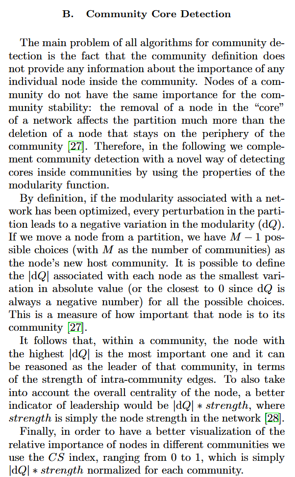

Let us call ```dQ*Strength``` the community core score. Whichever country inside a community has the highest community core score is deemed as the leader, which we can verify using the actual trade numbers at the regional level. For this exercise, we can first focus on the Asia-Oceania community first because it is their core that has changed and we would like to identify it using this technique. The community without the European countries and American countries is the Asia-Oceania community. I think using these 7 instances would help us observe these phenomenon better. 

There are mainly two objectives here: First is to implement the idea of community core for a community and its nodes, second is to see what it means to the trade network. One hindrance to this is the variety of partitions that are generated for the same set of trade flows every time leiden (or any modularity-based partition community detection algorithm) is run. There are two ways to proceed from here: Pick the partition that is similar to the one seen in the paper, so that it is consistent with the paper, or pick the most frequently occuring partition even if its different from the ones present in the paper. I will be going with the second option.

Let us consider the community with China (numerical code: 156) inside it for the 7 years chosen above. Will be using the top 500 trade flows because that is a fairly good approximation of the full ITN. Below are the partitions and the corresponding community diagrams for all the 7 years.

**1. 1995**: [[842, 484, 76, 862, 32, 170, 214, 152, 566, 414, 218, 188, 604, 320, 24, 340, 388, 586, 780, 50, 858, 222, 144, 266, 600], [124, 392, 156, 344, 410, 490, 757, 702, 458, 764, 360, 36, 682, 608, 784, 699, 591, 554, 512, 704, 634, 430, 96, 598], [251, 528, 826, 58, 40, 724, 372, 752, 208, 616, 203, 643, 579, 792, 376, 620, 246, 300, 703, 504, 384, 440, 233], [276, 380, 348, 711, 434, 705, 12, 788, 818, 364, 642, 191, 470, 100, 804, 716]]

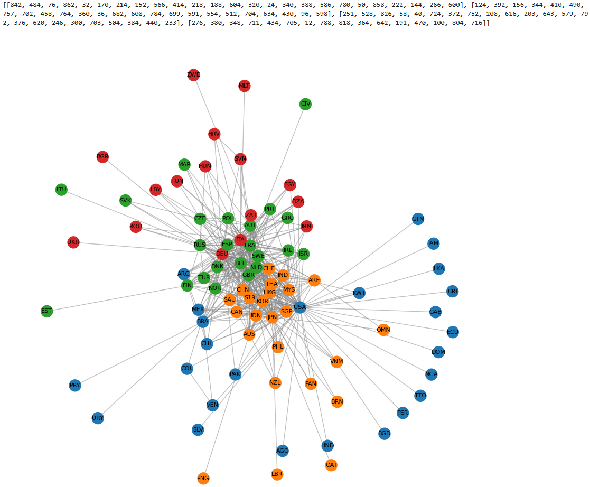

In this, the community with China in it looks like the geographical Asia-Oceania community (Green). Just that Europe seems to have been divided into two different communities (Red, Blue).

**2. 2000**: [[842, 76, 862, 32, 566, 170, 214, 188, 152, 368, 340, 320, 604, 24, 222, 780, 218, 50, 144, 586, 266, 44, 600, 388, 530, 533], [124, 484, 392, 156, 344, 410, 490, 702, 458, 764, 36, 360, 682, 608, 784, 699, 710, 591, 634, 554, 414, 704, 512, 736], [251, 826, 528, 56, 724, 40, 757, 372, 616, 752, 376, 348, 208, 620, 579, 246, 300, 504, 442, 72, 233], [276, 380, 203, 643, 792, 804, 112, 434, 703, 364, 642, 12, 788, 705, 398, 818, 92, 191, 760, 440]]

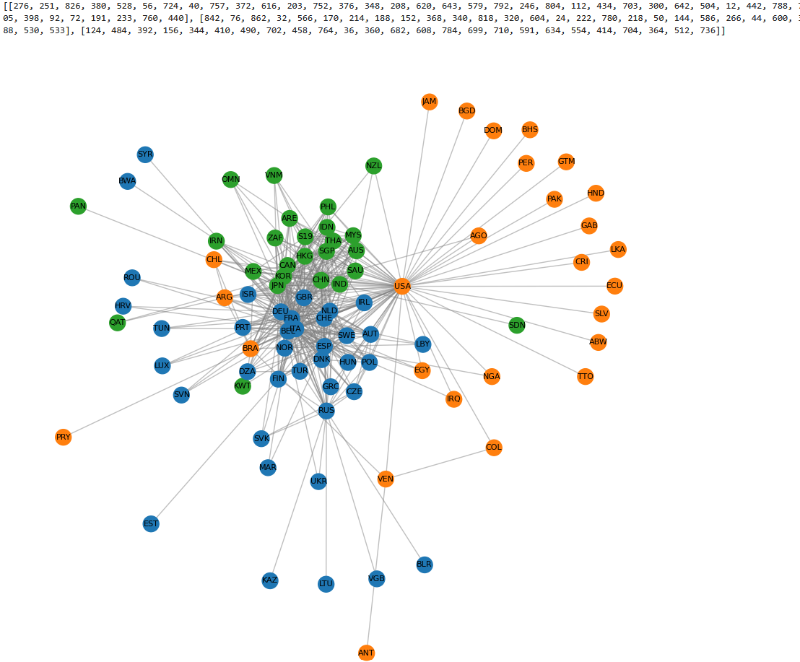

**3. 2005**: [[251, 276, 528, 826, 380, 56, 40, 724, 757, 616, 203, 372, 643, 348, 752, 620, 208, 579, 792, 376, 804, 246, 703, 112, 434, 642, 398, 300, 442, 504, 788, 705, 440, 191, 100, 233], [156, 392, 344, 410, 490, 458, 764, 36, 682, 702, 699, 360, 784, 608, 634, 364, 710, 554, 704, 414, 591, 586, 736, 512, 72], [124, 842, 484, 862, 76, 566, 32, 170, 152, 12, 368, 24, 214, 780, 604, 218, 188, 320, 340, 818, 222, 533, 50]]

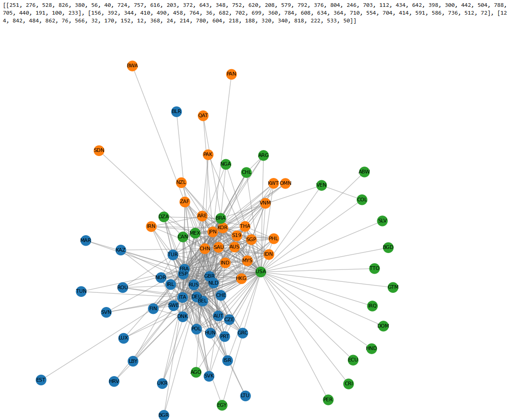

**4. 2010**: [[251, 276, 528, 380, 826, 56, 757, 40, 616, 724, 203, 643, 752, 348, 372, 620, 804, 579, 792, 208, 112, 703, 642, 246, 434, 12, 398, 504, 440, 300, 442, 705, 788, 31, 191, 100], [124, 842, 156, 484, 76, 862, 566, 32, 376, 170, 152, 24, 710, 591, 604, 368, 188, 554, 218, 214, 780, 320, 736, 818, 586, 340, 516, 50, 222], [392, 344, 410, 490, 36, 458, 702, 699, 784, 764, 682, 360, 704, 364, 634, 608, 414, 512, 430]]

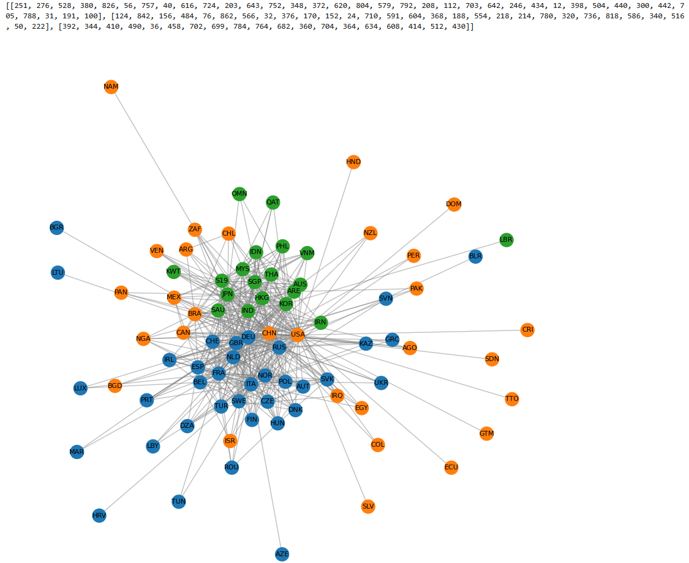

China and USA are part of the same community here. Evaluating community core for this community will be particularly interesting.

**5. 2015**: [[156, 842, 76, 710, 376, 152, 170, 862, 32, 604, 24, 398, 104, 586, 554, 566, 218, 214, 818, 50, 12, 320, 188, 340, 795, 780, 591, 231, 222, 72, 516, 408, 496, 600], [276, 251, 528, 826, 380, 757, 56, 616, 40, 203, 724, 643, 348, 372, 792, 752, 620, 208, 579, 703, 112, 642, 246, 804, 504, 705, 788, 442, 100, 300, 440, 434], [124, 484, 344, 392, 410, 490, 36, 458, 764, 702, 704, 699, 682, 360, 784, 608, 364, 368, 512, 634, 48, 414, 446, 584, 144, 834, 418, 116]]

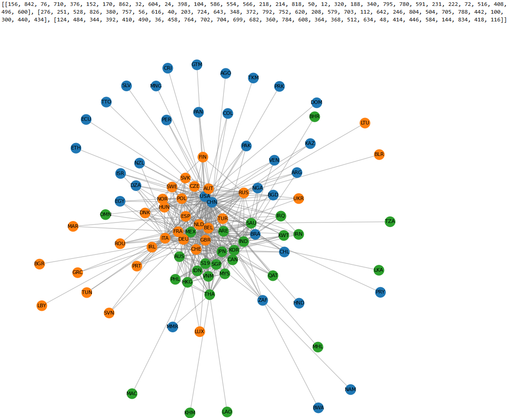

**6. 2020**: [[276, 528, 251, 380, 616, 826, 643, 757, 56, 40, 203, 724, 372, 348, 752, 792, 620, 642, 703, 208, 112, 376, 579, 246, 804, 504, 705, 100, 300, 442, 12, 440, 788, 854, 860, 191, 688, 428], [156, 842, 76, 784, 152, 368, 710, 604, 566, 170, 554, 398, 512, 364, 32, 24, 50, 586, 104, 818, 214, 180, 188, 320, 218, 795, 288, 340, 496, 324, 600], [484, 124, 392, 344, 410, 490, 36, 704, 458, 764, 702, 699, 360, 682, 608, 414, 634, 116, 524, 48, 418, 598]]

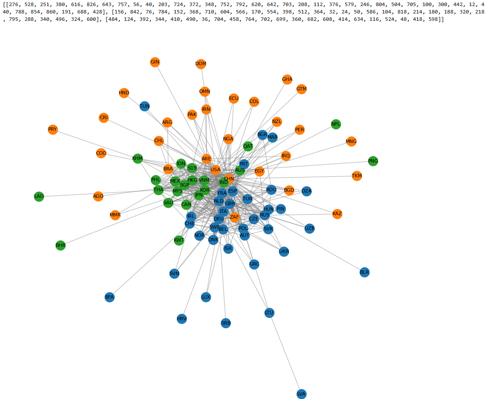

It should be noted that there were 2 most frequent partitions, one with USA and China in the same community and one with separate ones.

**7. 2024**: [[842, 156, 643, 76, 152, 368, 710, 604, 512, 170, 376, 398, 32, 180, 50, 554, 214, 586, 188, 24, 496, 566, 818, 320, 218, 364, 430, 104, 860, 51, 288, 340, 324, 795, 862, 112, 417, 600, 328, 508], [276, 528, 251, 616, 380, 56, 826, 40, 372, 203, 724, 348, 620, 792, 752, 642, 579, 703, 208, 705, 504, 246, 804, 12, 300, 100, 434, 688, 442, 191, 31, 440, 788, 428], [484, 124, 344, 392, 410, 704, 36, 490, 458, 360, 699, 764, 757, 682, 784, 702, 608, 634, 414, 116, 418, 524]]

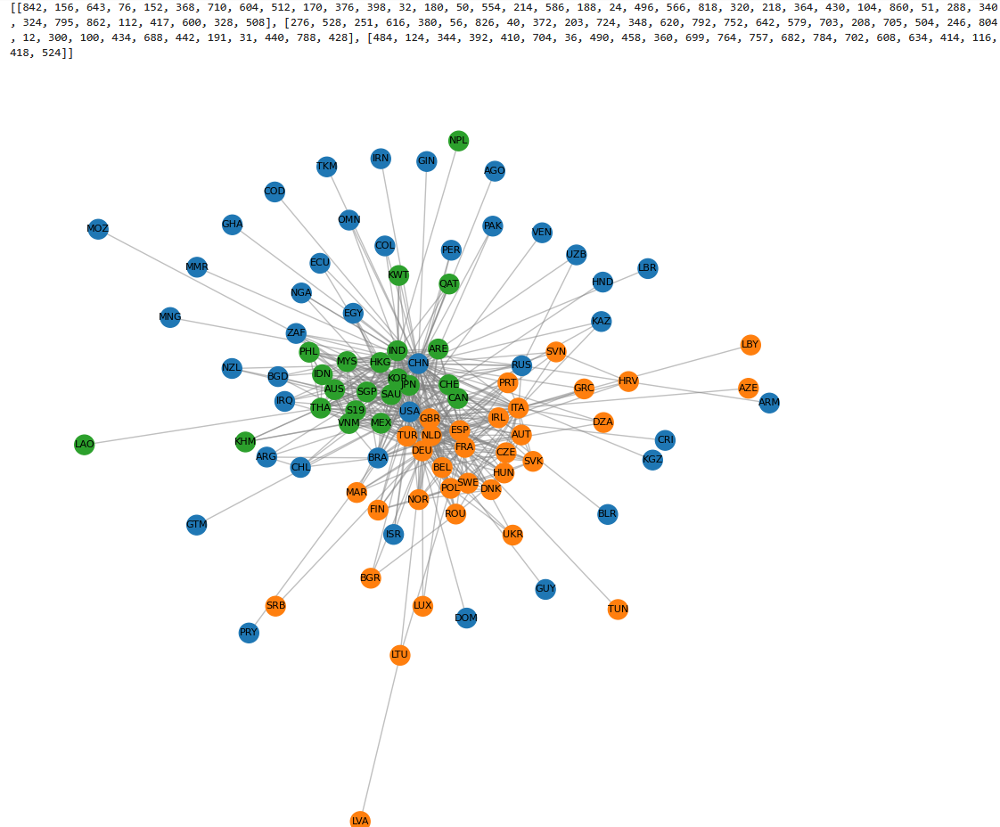

Even here, other partitions were formed but ended up choosing the one where both USA and China are in the same community.

First is community core can be evaluated for USA, China and Japan for respective communities. China & Japan are together in 1995, 2000 and 2005. Below are the community core scores for China and Japan for those years.

| Year |   China (156) |   Japan (392) |
| ---: | ------------: | ------------: |
| 1995 |  4,998,512.55 | 16,667,892.41 |
| 2000 | 10,990,031.28 | 19,128,780.13 |
| 2005 | 27,605,325.59 | 30,660,725.82 |

China's importance has progressively increased over the decade of 1995-2005. If we consider certain partitions from 2010-2024 which might have China and Japan in the same community, China's score would be higher than that of Japan.

China and USA are in the same community for rest of the 4 years (2010, 2015, 2020 and 2024). Below are the community core scores for these two.

| Year |    China (156) |      USA (842) |
| ---: | -------------: | -------------: |
| 2010 |  81,987,540.42 | 149,207,308.36 |
| 2015 | 144,784,442.53 | 145,709,680.78 |
| 2020 | 142,820,687.06 |  89,278,100.89 |
| 2024 | 267,692,519.01 | 132,213,636.65 |

These numbers should give a rough image of how China's importance has increased in the community it is part of with time.

I think with that, we have seen how how the leadership is quantified and how its change can be observed in a clear manner. The paper suggests another way to look at China's rise, which would be using the gravity model of trade. I plan to explore the topic of gravity model of trade in a separate article.

Coming back to the article, we have observed the global dynamics of the Asia-Oceania community disappearing and re-emerging as a distinct community in part 1 of this article [2]. We vaguely looked at the regional dynamics too, although not exactly how its present in the paper. It is clearly understood that leadership in the actual geographical Asia-Oceania community changed from Japan to China with time. Next the paper actually attempts to find if the global event and regional event are correlated. This is done in two ways: One using a custom simulation and another is clear empirical evidence. Rest of this article is about understanding these two phases and implementing them.

# 4. Linkage between Global and Regional Dynamics

The authors use the help of a custom simulation (Section V-A & V-B) to see if there is any correlation/linkage between the global dynamics and regional dynamics.

I think at the heart of the simulation lies on a couple of simple ideas: First is which country is going to reach out other countries and establish trade relations, and that a country with high intra-community trade/strength is more likely to reach out. Once a country decides to reach out, which country is it going to reach out: It has two options, it can be a country inside its community, or it can be one outside the community. That would be the first decision to make, whether to establish trade relations with a country in and around its geographies (intra-community) or a far away state (inter-community trade). If it decides to open trade relations with a far-away state, it will prefer a country which has a strong regional trade (in its community). Next is if the country decides to trade with a country inside its community/geographical region, it will probably want to open trade relations with one which already has an establish regional trade (aka high intra-community strength), but would prefer another country with higher international trade (inter-community strength). If a small Asian economy wants to establish trade relations with another Asian country, large countries with high international trade will probably be preferred. Countries prefer other countries which satisfy certain conditions, hence the name of the simulation **preferential attachment mechanism**.

These are the intuitions/assumptions on which the simulation is designed. It is partly based on intuition, and partly based on what needs to be observed given that is how countries decide whom to open trade relations with. Along with these, there are some parameters whose values are supposed to simulate certain conditions/constraints in the real-world. For example, when a country is trying to reach out, there are a lot of real-world conditions that make it easier/harder. For example, if there are a number of tariffs imposed on it, certain trade barriers, if its not part of any existing trade agreement, non-existence of a reliable supply chain and so on, these factors make it harder. To simulate these effects, certain parameters are appropriately chosen.

With that, let us go ahead and implement the simulation from the details shared in the paper. I don't plan to share line by line implementation here, but only certain decisions taken to build the simulation.

**1. Initial Setup**: Below is the excerpt from the paper on initial setup.

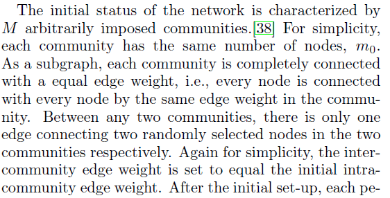

The authors seems to have taken 3 communities with 5 countries each inside them. The initial edge weight is not explicitly mentioned, we can go ahead with **0.1**.

Rest are the simulation steps which is quite simple to read from the paper. The authors are able to simulate the disappearance of appearance of communities with the simulation, and hopefully we should be able to reproduce that (that is the main objective of the simulation). We stop at different simulated periods, apply leiden on the simulation ITN and check the number of communities generated. This is how we see the appearance/disappearance of communities with time. Before going the results of implementation, let us look at the expected results from the paper.

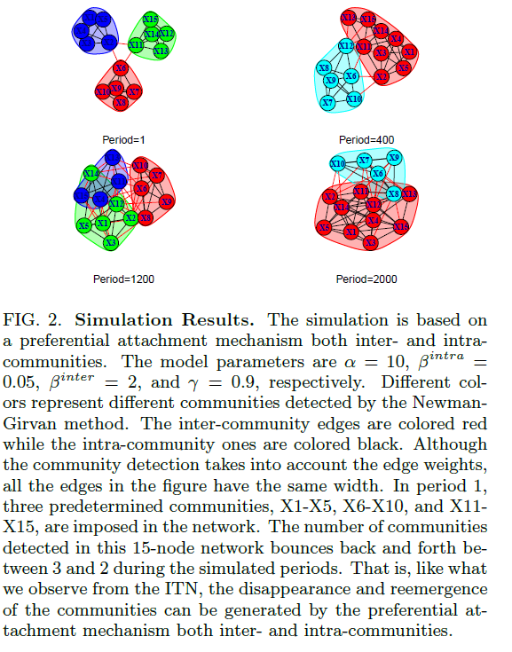

Coming to the simulation results, below is how the network looks like at ```period = 2000```.

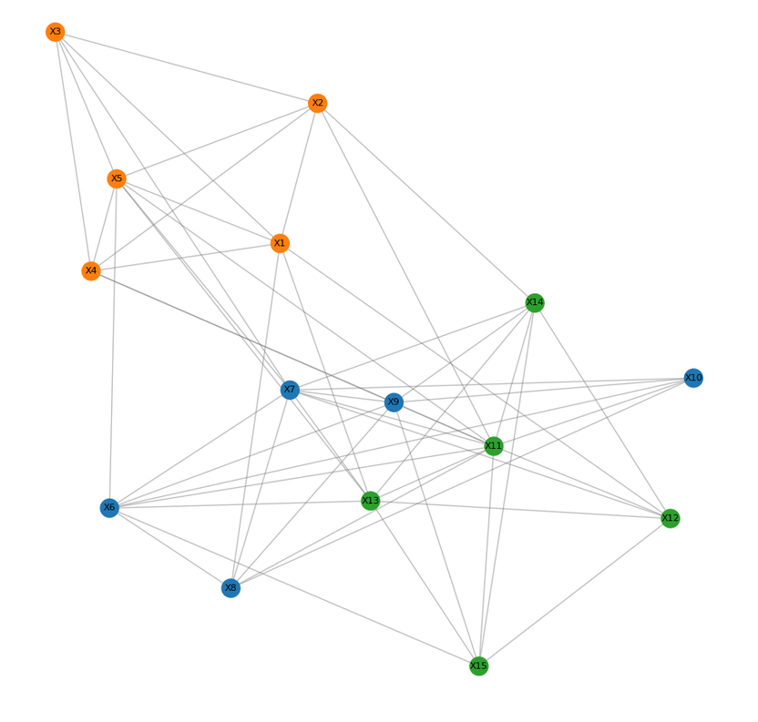

At 2500 periods, we observe the disappearance of a community.

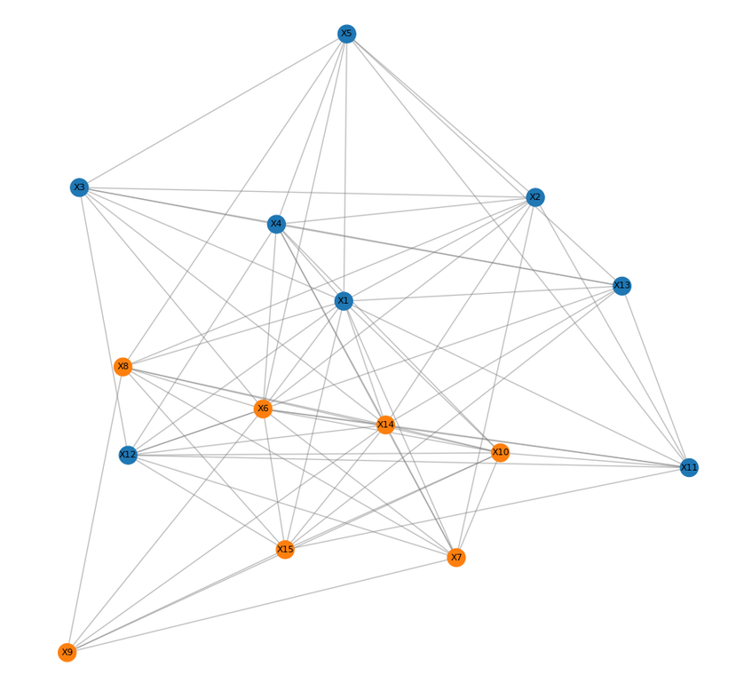

At 2750 periods, we see the emergence of a 3rd community but with a difference.


and so on.

Post simulation, we are able to clearly observe the disappearance/re-emergence of communities on the simulation. With that, we have successfully built a model with preferential attachment both within and outside of communities.

# 5. Empirical Evidence, Agreements & Policies

## 5.1 Empirical Evidence

Post simulation results, the authors go back to the dataset and share some empirical evidence for the preferential attachment mechanism both within and across communities.

To evaluate the empirical evidence, the paper goes with the algorithm generated communities across years. The main concern I have with using communities generated by Leiden is the communities don't remain the same across years. Because we are measuring intra and inter-community trade across years, I think it is best to use fixed, geography-based communities. I think we will be able to produce consistent measurements with that (instead of ever-varying partitioning algorithm). Below will be the Asia-Oceania community.

```python
asia_oceania_iso3 = [
    "AFG", "ARM", "AUS", "AZE", "BHR", "BGD", "BTN", "BRN", "KHM", "CHN",
    "CYP", "FJI", "GEO", "IND", "IDN", "IRN", "IRQ", "ISR", "JPN", "JOR",
    "KAZ", "KIR", "KWT", "KGZ", "LAO", "LBN", "MYS", "MDV", "MHL", "FSM",
    "MNG", "MMR", "NRU", "NPL", "NZL", "PRK", "OMN", "PAK", "PLW", "PNG",
    "PHL", "QAT", "WSM", "SAU", "SGP", "SLB", "KOR", "LKA", "SYR", "TJK",
    "THA", "TLS", "TON", "TKM", "TUV", "ARE", "UZB", "VUT", "VNM", "YEM"
]
```

Below are the proper country names for reference.

| Country     | Country              | Country    | Country          | Country          | Country                          |
| ----------- | -------------------- | ---------- | ---------------- | ---------------- | -------------------------------- |
| Afghanistan | Armenia              | Australia  | Azerbaijan       | Bahrain          | Bangladesh                       |
| Bhutan      | Brunei               | Cambodia   | China            | Cyprus           | Fiji                             |
| Georgia     | India                | Indonesia  | Iran             | Iraq             | Israel                           |
| Japan       | Jordan               | Kazakhstan | Kiribati         | Kuwait           | Kyrgyzstan                       |
| Laos        | Lebanon              | Malaysia   | Maldives         | Marshall Islands | Micronesia (Federated States of) |
| Mongolia    | Myanmar              | Nauru      | Nepal            | New Zealand      | North Korea                      |
| Oman        | Pakistan             | Palau      | Papua New Guinea | Philippines      | Qatar                            |
| Samoa       | Saudi Arabia         | Singapore  | Solomon Islands  | South Korea      | Sri Lanka                        |
| Syria       | Tajikistan           | Thailand   | Timor-Leste      | Tonga            | Turkmenistan                     |
| Tuvalu      | United Arab Emirates | Uzbekistan | Vanuatu          | Vietnam          | Yemen                            |

Similarly, defining the Americas community in the following manner.

```python
americas_iso3 = [
    # Northern America
    "CAN", "USA",

    # Central America
    "BLZ", "CRI", "SLV", "GTM", "HND", "MEX", "NIC", "PAN",

    # Caribbean
    "ATG", "BHS", "BRB", "CUB", "DMA", "DOM", "GRD", "HTI", "JAM",
    "KNA", "LCA", "VCT", "TTO",

    # South America
    "ARG", "BOL", "BRA", "CHL", "COL", "ECU", "GUY", "PRY", "PER",
    "SUR", "URY", "VEN"
]
```

Let us start with measuring the inter and intra-community trade ratio between Asia-Oceania and the Americas community. One thing that seems to be unclear is intra-community trade of which community is considered as the denominator of this ratio. Therefore, let us start with the following:

```
inter_to_intra_ratio = Total Inter-Community Trade between Asia-Oceania and Americas / Intra-Community Trade in Asia-Oceania + Intra-Community Trade in the Americas
```

We get the following graph:

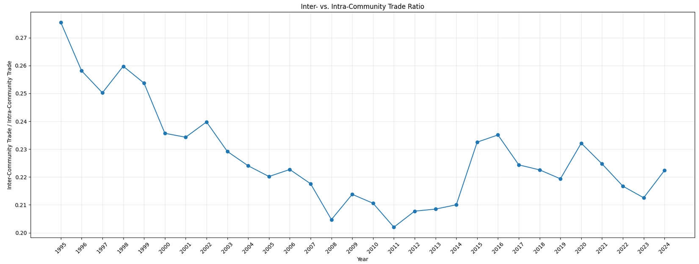

There are only a few years where the inter-community trade exceeded 25% of the cumulative intra-community trade of both communities. It dipped to the lowest in the years 2008 and 2011 post which it has improved. But this is not the graph presented in the paper.

Consider the below graph of inter-community trade to Asia-Oceania intra-community trade.

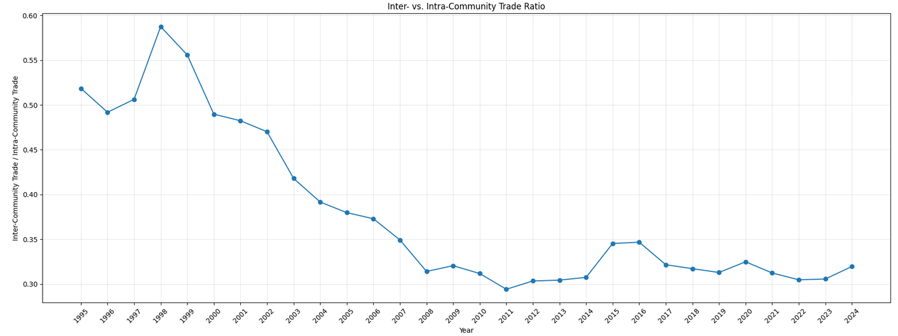

This is the graph presented in the paper, but due to obvious reasons (like the communities not matching etc.,), it isn't the exact graph. From the point of view of the Asia-Oceania community, the ratio seems to have peaked between 1995-2002 with an average of ~45-50%. Post that, it has been around 30-35%. To know what happened exactly, let us look at the absolute inter and intra-community trade graphs below.

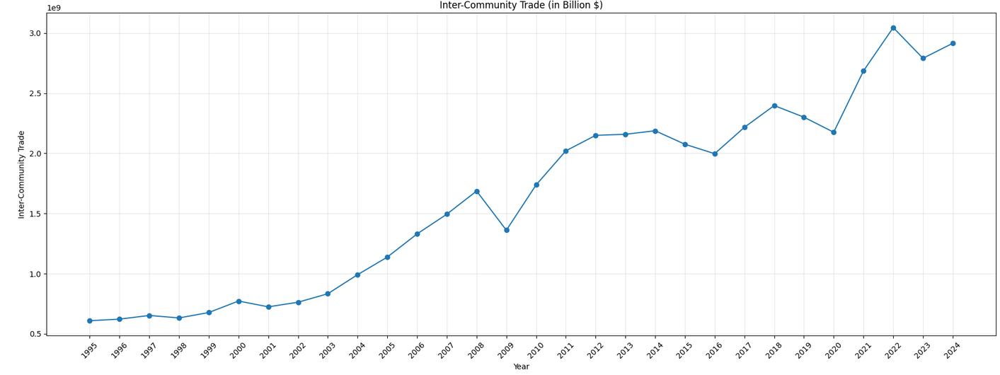

The inter-community has consistently increased with time. Now onto the intra-Asia-Oceania trade.

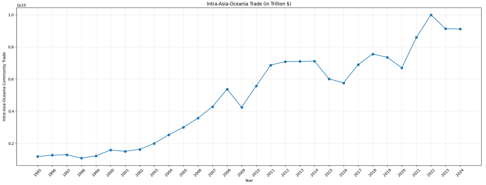

These two graphs tell that the Asia-Oceania community has become a dominant region in both international and regional trade.

Another interesting measurement (not present in the paper) is the inter to intra community trade of the Americas. Below is the graph.

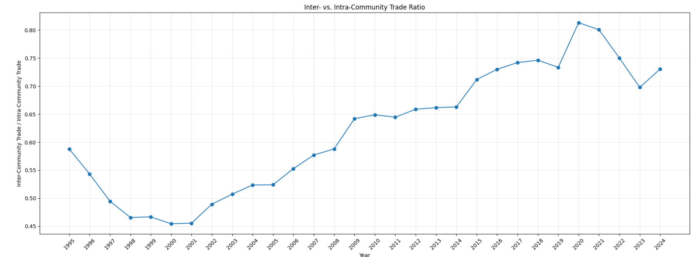

Now jumping to the final diagram that does a crisp comparison between China and Japan on both regional and international trade. For this, I will be considering the following exhaustive list of countries.

```python
countries_iso3 = [
    "AFG", "ALB", "DZA", "ASM", "AND", "AGO", "ATG", "AZE", "ARG", "AUS",
    "AUT", "BHS", "BHR", "BGD", "ARM", "BRB", "BEL", "BMU", "BTN", "BOL",
    "BIH", "BWA", "BRA", "BLZ", "IOT", "SLB", "VGB", "BRN", "BGR", "MMR",
    "BDI", "BLR", "KHM", "CMR", "CAN", "CPV", "CYM", "CAF", "LKA", "TCD",
    "CHL", "CHN", "CXR", "CCK", "COL", "COM", "MYT", "COG", "COD", "COK",
    "CRI", "HRV", "CUB", "CYP", "CSK", "CZE", "BEN", "DNK", "DMA", "DOM",
    "ECU", "SLV", "GNQ", "ETH", "ERI", "EST", "FLK", "FJI", "FIN", "FRA",
    "PYF", "ATF", "DJI", "GAB", "GEO", "GMB", "PSE", "DEU", "DDR", "GHA",
    "GIB", "KIR", "GRC", "GRL", "GRD", "GUM", "GTM", "GIN", "GUY", "HTI",
    "HND", "HKG", "HUN", "ISL", "IDN", "IRN", "IRQ", "IRL", "ISR", "ITA",
    "CIV", "JAM", "JPN", "KAZ", "JOR", "KEN", "PRK", "KOR", "KWT", "KGZ",
    "LAO", "LBN", "LSO", "LVA", "LBR", "LBY", "LTU", "LUX", "MAC", "MDG",
    "MWI", "MYS", "MDV", "MLI", "MLT", "MRT", "MUS", "MEX", "S19", "MNG",
    "MDA", "MNE", "MSR", "MAR", "MOZ", "OMN", "NAM", "NRU", "NPL", "NLD",
    "ANT", "CUW", "ABW", "SXM", "BES", "NCL", "VUT", "NZL", "NIC", "NER",
    "NGA", "NIU", "NFK", "NOR", "MNP", "FSM", "MHL", "PLW", "PAK", "PAN",
    "PNG", "PRY", "PER", "PHL", "PCN", "POL", "PRT", "GNB", "TLS", "QAT",
    "ROU", "RUS", "RWA", "BLM", "SHN", "KNA", "AIA", "LCA", "SPM", "VCT",
    "SMR", "STP", "SAU", "SEN", "SRB", "SYC", "SLE", "R20", "IND", "SGP",
    "SVK", "VNM", "SVN", "SOM", "ZAF", "ZA1", "ZWE", "ESP", "SSD", "SDN",
    "SUR", "SWZ", "SWE", "CHE", "SYR", "TJK", "THA", "TGO", "TKL", "TON",
    "TTO", "ARE", "TUN", "TUR", "TKM", "TCA", "TUV", "UGA", "UKR", "MKD",
    "SUN", "EGY", "GBR", "TZA", "USA", "PUS", "BFA", "URY", "UZB", "VEN",
    "WLF", "WSM", "YEM", "SCG", "ZMB"
]
```

To find China's total inter-community trade, I will remove the Asia-Oceania community from the above countries list and calculate the total trade. Putting all the 4 plots together (Japan and China's regional and inter-community trade), below is the graph obtained.

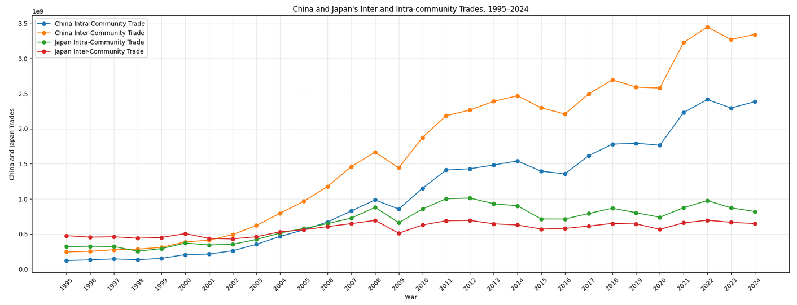

One of the main differences between this graph and the one in the paper is that here, Japan's intra-community trade is consistently higher than its inter-community trade post 2005. That is not the case in Figure 4 from the paper. Looks like there is a drastic mismatch between what constitutes intra and inter, hence the difference. Apart from that, observations made in the paper can be made sense with the above graph. At around 2005, China beats Japan in terms of both intra and inter-community trade, marking the change in leadership in the Asia-Oceania community. Along with that, China's Inter-community trade rose first, and the intra-community trade followed, which is what the authors have been trying to convey all along. One caveat is that the following observation cannot be confirmed as of now from our graph.

```
Furthermore, for both countries, the intra-community trade follows closely to the inter-community trade, which can be viewed as evidence of the intra-community preferential at tachment mechanism.
```

The body of the paper is completed with the following comment.

```
Last but not least, it is a well observed fact that the Asia-Oceania community is an active participant of the global production chain (or global value chain). Therefore, the intra-community preference over the
nodes with more inter-community strength can be understood as the incentive to have better market access through the regional big player in the global production chain.
```

That Asia-Oceania community is an active participant is clear from the consistent increase in both inter and intra-community trade of the community (as seen earlier).

## 5.2 China's Effective RTAs

Below are all the RTAs (Regional Trade Agreements) China has had with multiple countries over the years.

| RTA Name                        | Coverage         | Date of entry into force          | Status   |
| ------------------------------- | ---------------- | --------------------------------- | -------- |
| China - Hong Kong, China        | Goods & Services | 29-Jun-03                         | In Force |
| China - Macao, China            | Goods & Services | 17-Oct-03                         | In Force |
| ASEAN - China                   | Goods & Services | 01-Jan-2005 (G) / 01-Jul-2007 (S) | In Force |
| Chile - China                   | Goods & Services | 01-Oct-2006 (G) / 01-Aug-2010 (S) | In Force |
| China - New Zealand             | Goods & Services | 01-Oct-08                         | In Force |
| Pakistan - China                | Goods & Services | 01-Jul-2007 (G) / 10-Oct-2009 (S) | In Force |
| China - Singapore               | Goods & Services | 01-Jan-09                         | In Force |
| Peru - China                    | Goods & Services | 01-Mar-10                         | In Force |
| Hong Kong, China - New Zealand  | Goods & Services | 01-Jan-11                         | In Force |
| China - Costa Rica              | Goods & Services | 01-Aug-11                         | In Force |
| EFTA - Hong Kong, China         | Goods & Services | 01-Oct-12                         | In Force |
| Switzerland - China             | Goods & Services | 01-Jul-14                         | In Force |
| Iceland - China                 | Goods & Services | 01-Jul-14                         | In Force |
| Hong Kong, China - Chile        | Goods & Services | 09-Oct-14                         | In Force |
| Australia - China               | Goods & Services | 20-Dec-15                         | In Force |
| China - Korea, Republic of      | Goods & Services | 20-Dec-15                         | In Force |
| Hong Kong, China - Macao, China | Goods & Services | 27-Oct-17                         | In Force |
| China - Georgia                 | Goods & Services | 01-Jan-18                         | In Force |
| Hong Kong, China - Georgia      | Goods & Services | 13-Feb-19                         | In Force |
| ASEAN - Hong Kong, China        | Goods & Services | 11-Jun-19                         | In Force |
| Hong Kong, China - Australia    | Goods & Services | 17-Jan-20                         | In Force |
| China - Mauritius               | Goods & Services | 01-Jan-21                         | In Force |
| China - Cambodia                | Goods & Services | 01-Jan-22                         | In Force |
| China - Nicaragua               | Goods & Services | 01-Jan-24                         | In Force |
| China - Ecuador                 | Goods            | 01-May-24                         | In Force |
| China - Serbia                  | Goods            | 01-Jul-24                         | In Force |
| China - Maldives                | Goods & Services | 01-Jan-25                         | In Force |
| China - Belarus                 | Services         | 01-Jan-26                         | In Force |
| China - Congo                   | Goods            | 01-Apr-26                         | In Force |

There are 29 entries here. Where as Japan seems to have 17 entries for the same time period.

| RTA Name                  | Coverage         | Date of entry into force          | Status   |
| ------------------------- | ---------------- | --------------------------------- | -------- |
| Japan - Singapore         | Goods & Services | 30-Nov-02                         | In Force |
| Japan - Mexico            | Goods & Services | 01-Apr-05                         | In Force |
| Japan - Malaysia          | Goods & Services | 13-Jul-06                         | In Force |
| Chile - Japan             | Goods & Services | 03-Sep-07                         | In Force |
| Japan - Thailand          | Goods & Services | 01-Nov-07                         | In Force |
| ASEAN - Japan             | Goods & Services | 01-Dec-2008 (G) / 01-Aug-2020 (S) | In Force |
| Japan - Indonesia         | Goods & Services | 01-Jul-08                         | In Force |
| Brunei Darussalam - Japan | Goods & Services | 31-Jul-08                         | In Force |
| Japan - Philippines       | Goods & Services | 11-Dec-08                         | In Force |
| Japan - Switzerland       | Goods & Services | 01-Sep-09                         | In Force |
| Japan - Viet Nam          | Goods & Services | 01-Oct-09                         | In Force |
| India - Japan             | Goods & Services | 01-Aug-11                         | In Force |
| Japan - Peru              | Goods & Services | 01-Mar-12                         | In Force |
| Japan - Australia         | Goods & Services | 15-Jan-15                         | In Force |
| Japan - Mongolia          | Goods & Services | 07-Jun-16                         | In Force |
| EU - Japan                | Goods & Services | 01-Feb-19                         | In Force |
| United Kingdom - Japan    | Goods & Services | 01-Jan-21                         | In Force |

But between 2000 and 2014 (when the paper was published), China has 14 RTAs whereas Japan has 13 of them. So just the RTAs cannot be reliably used to prove the increase in the regional trade, but can be used as a supportive accessory along with the numbers presented earlier.

# 6. Discussion & Learnings

With that, we have offically come to the end of the paper implementation. We have attempted to check/implement every observation, note, table, figure, procedure etc., present in the paper. The below are broadly the learnings and themes from this entire exercise.

1. Working with CEPII-BACI Dataset: Exploring and working with a quality international trade dataset, which has now opened opportunities in terms of all the different kinds of analysis that can be done on this dataset along with all the other datasets constructed and shared by CEPII. In this analysis, we used the simplest of the trade flows, the bilateral trade flows which is the aggregate of all flows. But a lot of analysis can be done in terms of regions, countries, products and so on.    
2. ITN and its Evolution: Got a rough idea of what the international trade network looks like, looking at its evolution over time helped understand some major changes that have happened in the ITN.   
3. Observing a country's economic strategy: The authors essentially dissect China's strategy and policy to build their country, between 1995 to 2014. This is broadly the theme of the paper and to see how it can be done using quantitative methods was interesting.  
4. Algorithmic identification of communities and community leaders: This is where the partitioning algorithms and the community core method described in the paper came in handy.   
5. Modelling a mechanism: The preferential attachment mechanism is what the authors hypothesised and used a simulation/model along with empirical evidence to demonstrate the same. Using a model/simulation to demonstrate an event observed in the real-world was very intriguing.  
6. General analysis of the trade data: Apart from the simulation and community core scores, rest of this article was pure analysis to verify certain observations made by the authors.   

# 7. Conclusion & Next Steps

With that, we have come to the end of this paper implementation. We got a good look into the aggregate international trade network, how it has evolved with time, attempted to observe certain unique phenomena that have happened in the past with the Asia-Oceania community, used a variety of methods to do the same (starting from simple partitioning of the international trade network to algorithmically finding leaders in the community through community core method, building a model to simulate one of the main phenomena from the paper and finally using the trade data in different ways to present empirical evidence for the same). It was quite a learning from both getting a picture of international trade as well as all the different quantitative methods used in the paper to prove/observe a particular hypothesis.

You may find all the code here [3]. The code too is divided into 5 phases used in this 2-part article. Feel free to download and use the code as you may wish to.

There are two research directions I am interested at the moment.

1. **Network Models and International Trade**: There is a line of research which looks at international trade, global supply chains and production networks using network models (one of the most intuitive ways to look at trade). I am interested in how well network models can describe different economic phenomena and can help make policy prescriptions. This article and the previous one supposed to be in line with this, these articles are of the descriptive kind.    

2. **Nation's Monetary Policy and Supply Shocks**: This is about monetary policy and how it can be made more accurate by taking global factors into account, there is already a good body of literature on this. The specific case I have been pondering upon is from the COVID-19 time period. COVID-19 pandemic led to the disruption of global supply chains and production networks. It takes real work and significant amount of time to fix it, and at times, the supply chains cannot be fixed and alternatives will have to be built. On the demand side, the pandemic caused a clear recession, a contraction in aggregate demand. The natural monetary policy response of nations was to reduce the interest rates in order to increase the aggregate demand. But what seems to have happened is that the aggregate demand and inflation picked up faster than the supply, which led to a clear tightening of monetary policy in 2022-23. "Could the interest rates be reduced according to the rate of recovery of the supply chains and production networks?" is a question I want to research on.

Moving forward, I would like to take up reports and publications on these topics and discuss them here.

Thank you for coming this far and reading this article. See you in the next one.

Cheers!   
Adwaith

## References

1. [The Rise of China in the International Trade Network: A Community Core Detection Approach, 2014](https://arxiv.org/abs/1404.6950)    
2. [Analysis of ITN with Community Detection - Part 1](/economics/2026/07/12/analysis-of-itn-with-community-detection-part1.html)   
3. [Analysis of ITN & Community Detection](https://github.com/adwait1-g/economics-papers/tree/main/1.%20Analysis%20of%20ITN%20%26%20Community%20Detection)    
4. [Mundell-Fleming Trilemma - Wikipedia](https://en.wikipedia.org/wiki/Impossible_trinity)   
5. [Assessing the Emerging Global Financial Architecture: Measuring the Trilemma's Configurations over Time - Dec 2008, NBER](https://www.nber.org/papers/w14533)   