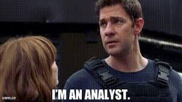

Hello everyone,

I am Adwaith.

I have a B.Tech in Computer Science from the National Institute of Technology Karnataka, Surathkal (batch of 2016-20). I worked at Cisco Systems for close to 4 years as a software engineer. Post that, I earned the Master in Management (MiM) degree from the ESCP Business School, Paris and the Post-Graduate Diploma in Management - International Business (PGDM-IB) from the Mangement Development Insttute (MDI), Gurgaon. I am currently working as a Risk Analyst at American Express' Credit and Fraud Risk Decision Sciences team.

I got interested in cybersecurity early on during my bachelors, all from a workshop conducted by 2 of my favorite seniors. My interest in it got me an internship at Cisco, then a job there. So did computer security for good 6-7 years. Post that, I decided to pursue an education in management and landed at the PGDM-IB/MiM dual-degree program at MDI Gurgaon/ESCP Business School. I started off with fields I had some familiarity with - information systems, operations management given my background in computer science. With time, my interest towards the "big picture" grew, so today, I am mostly into corporate strategy and economics.

These days, I call myself an analyst because it sounds cool (but it sounds utterly cliched too, every other person is an analyst these days lol). I'll ride with that for time being ;)

This blog has seen its highs and lows, as like my life :P. I blogged quite frequently starting 2019 until late 2021 on [cybersecurity](/cybersecurity/). When I started my management education again, I revamped it and attempted to write something on some stuff I studied ([link](/management/)). I have been fascinated with economics for quite some time, so have been trying brush up my basics in order to read publications, reports on different topics in [economics](/economics/) and possibly write about it, share paper implementations and experiments here.

If any of this interests you, feel free to ping me on any of the social media platforms, will be happy to have a discussion.

Cheers!   
Adwaith
